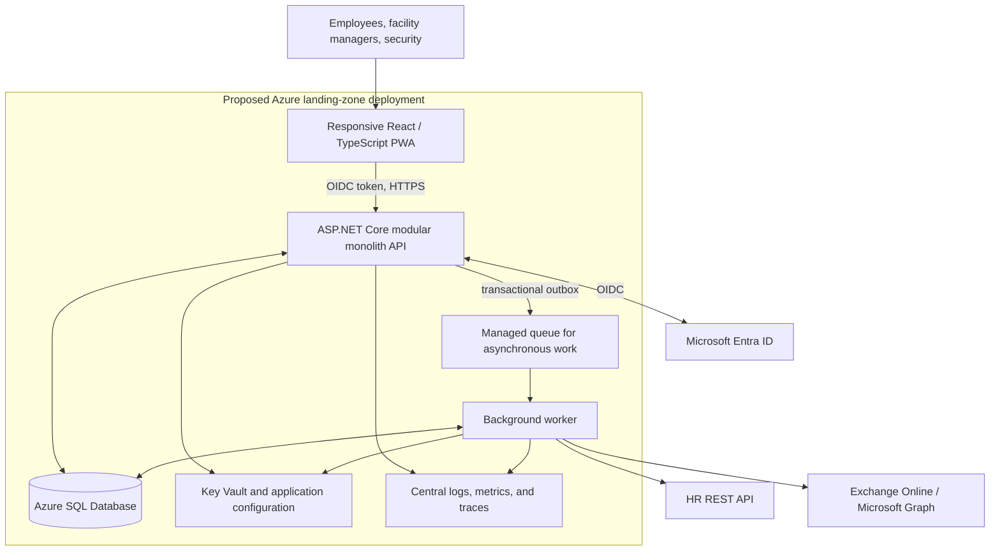
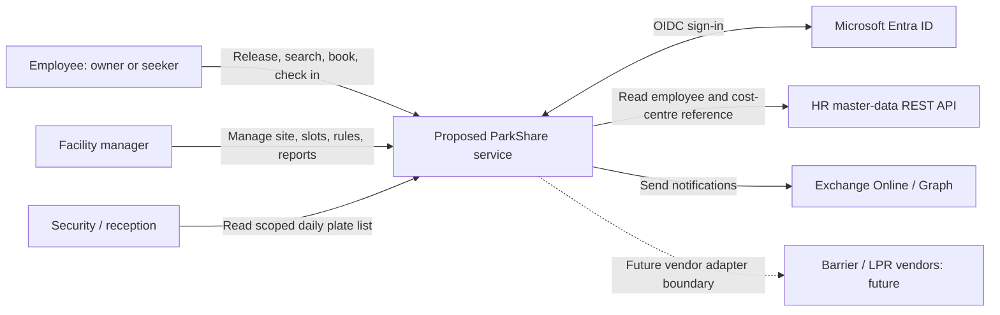
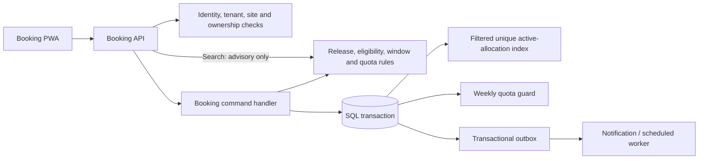
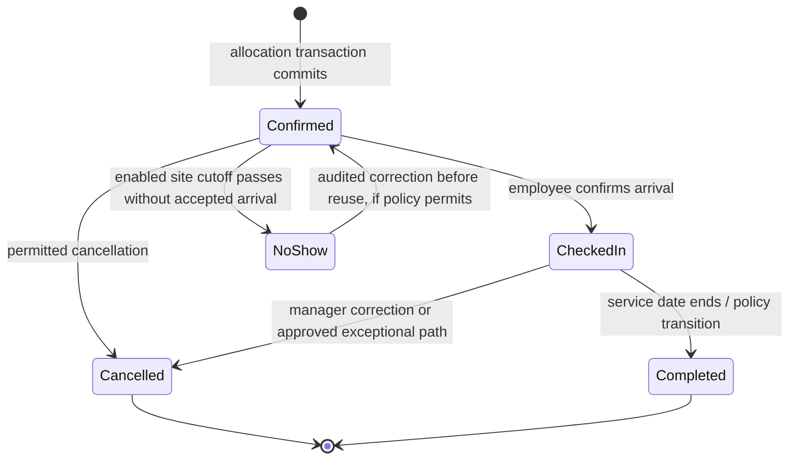

# ParkShare Service Context

**Service:** parkshare  
**Product Owner:** Eurofins  
**Service Owner:** Eurofins  
**Architect:** Gustavo Rocha  
**Support Team:** None assigned  
**JIRA:** None; assessment only  
**Last Updated:** 2026-11-20  
**Approval status:** Approved as an assessment baseline on 2026-11-20  
**Lifecycle:** Discovery / PoC / Assessment  
**Type:** Proposed REST API + PWA

> **Status:** Approved assessment-stage specification for a proposed service. No ParkShare implementation was found in the repository. This approval accepts the assumptions and proposed design for assessment only; it does not claim implementation evidence or authorize production use.

## Quick Reference

ParkShare is a proposed employee parking-slot sharing service for Contoso Group. It is intended to let assigned-slot owners release unused parking days and let eligible employees search and book those days across 12 sites in six countries. The assignment describes approximately 8,000 employees, 1,500 owned or rented parking slots, and approximately 40% average-day vacancy among assigned slots.

- **Owner/contact:** Product Owner and Service Owner: Eurofins; Architect: Gustavo Rocha; no dedicated support team assigned.
- **Authentication:** Corporate single sign-on using Entra ID / OIDC is required by the assignment; claim mapping and app registration are unverified.
- **API/base URL:** No deployed endpoint or OpenAPI contract exists in this repository. Proposed REST API; host and public/internal routing are not selected.
- **Key capabilities:** Slot master data, release, site/date availability, booking, cancellation, no-show handling, daily site plate list, and occupancy reporting.
- **Data sensitivity:** Licence plates, employee identity, bookings, check-ins/presence, and access-list use are personal data; retention and access policy need DPO/works-council approval.

### Contents

- [ParkShare Service Context](#parkshare-service-context)
  - [Quick Reference](#quick-reference)
    - [Contents](#contents)
  - [Overview](#overview)
    - [Business Context](#business-context)
    - [Users and Stakeholders](#users-and-stakeholders)
    - [Scope Boundary](#scope-boundary)
  - [Architecture](#architecture)
    - [Status and Deployment View](#status-and-deployment-view)
    - [System Interactions](#system-interactions)
    - [System Context and Booking Components](#system-context-and-booking-components)
    - [Proposed Components and Data Stores](#proposed-components-and-data-stores)
  - [Functional Requirements](#functional-requirements)
    - [MVP Capabilities](#mvp-capabilities)
    - [Future Capabilities](#future-capabilities)
  - [API Specification](#api-specification)
    - [Proposed Endpoint Inventory](#proposed-endpoint-inventory)
    - [Contract and Error Behavior (Proposed)](#contract-and-error-behavior-proposed)
  - [Data Model](#data-model)
    - [Proposed Entities](#proposed-entities)
    - [Relationships and Data Handling](#relationships-and-data-handling)
  - [Business Rules](#business-rules)
    - [Identity, Scope, and Inventory](#identity-scope-and-inventory)
    - [Booking Policy and Concurrency](#booking-policy-and-concurrency)
    - [Proposed Booking Lifecycle](#proposed-booking-lifecycle)
    - [Local Time, Check-In, and No-Show Processing](#local-time-check-in-and-no-show-processing)
    - [Notifications, Security Access, and Reporting](#notifications-security-access-and-reporting)
    - [Future Barrier/Edge Rules](#future-barrieredge-rules)
  - [Compliance \& Audit](#compliance--audit)
    - [Data Classification and Privacy](#data-classification-and-privacy)
    - [Access Control](#access-control)
    - [Retention and Audit](#retention-and-audit)
  - [Operations](#operations)
    - [Ownership and Support](#ownership-and-support)
    - [Environments, Deployment, and Change](#environments-deployment-and-change)
    - [Observability and Runbooks](#observability-and-runbooks)
    - [Availability, Recovery, and Cost](#availability-recovery-and-cost)
  - [Non-Functional Requirements](#non-functional-requirements)
  - [Known Issues \& Limitations](#known-issues--limitations)
  - [Additional Context](#additional-context)
    - [Assessment Approval and Deferred Decisions](#assessment-approval-and-deferred-decisions)
    - [Proposed Architecture Decisions](#proposed-architecture-decisions)
    - [Proposed Technology and Engineering Toolchain](#proposed-technology-and-engineering-toolchain)
    - [Developer and AI-Assisted Engineering Guidance](#developer-and-ai-assisted-engineering-guidance)
    - [Delivery Plan and Release Gates](#delivery-plan-and-release-gates)
    - [Top Risks and Mitigations](#top-risks-and-mitigations)
    - [Glossary](#glossary)
    - [Source Inventory and Provenance](#source-inventory-and-provenance)

## Overview

### Business Context

Contoso Group operates offices in six countries. It owns or rents approximately 1,500 parking spaces; around 900 are permanently assigned based on factors including seniority, management, disability, and shift work, and the remainder are first-come-first-served. The assignment reports that around 40% of assigned spaces are empty on an average day because owners work remotely or travel, while employees without assigned spaces can be unable to find parking. Facility managers currently manage requests through email and spreadsheets, with limited visibility into actual use.

The proposed service makes an owner's approved unused slot/date available for another employee while preserving the original assignment. The intended outcomes are better utilisation, fewer failed parking searches and public-parking expenses, and site-level occupancy information. No quantified adoption, utilisation, cost-saving, or service-level baseline beyond the assignment is available.

### Users and Stakeholders

| Actor | Need and proposed service interaction |
|---|---|
| Slot owner | Release an assigned slot for selected days; cancel or reclaim a release subject to booking policy; optionally automate release from calendar in a later phase. |
| Slot seeker | Find availability by site/date, book an eligible slot, receive a reminder, and cancel. |
| Facility manager | Maintain site/slot inventory, attributes, rules, quotas, priority configuration, occupancy reporting, and conflict/exception handling for assigned sites. |
| Security / reception | Obtain a current site/day list of authorised licence plates and handle visitor processes. The visitor booking workflow is not part of MVP. |
| HR / Works council | Ensure fair allocation, data minimisation, GDPR compliance, and limits on individual presence monitoring. |
| Finance | Reduce public-parking expense claims; cost-centre recharging is a possible later capability. |
| IT Operations | Operate a secure, observable, supportable solution aligned with the Azure landing zone and corporate standards. |

### Scope Boundary

| Phase | Included or considered |
|---|---|
| MVP (target: four months) | Entra SSO; employee profile with one or more plates; facility-managed sites, slots and attributes; owner release by one or more full days; site/date search and exclusive booking; site-specific booking window, weekly quota and priority rules; cancellation; configured no-show release; email and push notifications; daily security plate list; basic facility occupancy dashboard. |
| Post-MVP, architecture should not block | At least two barrier/LPR vendor integrations; Outlook calendar/out-of-office release; waiting list and fair allocation/lottery; host-booked visitors; EV charging session booking/billing; external-customer SaaS and paid private sharing. |
| Explicit MVP exclusions in current proposal | Half-day granularity, Teams notifications, native mobile applications, automated calendar release, visitor workflow, barrier/LPR control, waiting list/lottery, EV billing, SaaS onboarding/billing. Confirm remaining scope choices with the Product Owner. |

## Architecture

### Status and Deployment View

The following is a proposed target architecture derived from the challenge response, not an observed deployment. The repository has no ParkShare application, API, schema, pipeline, or infrastructure-as-code. One Azure region and a tenant-aware modular monolith are proposal choices.

The browser/PWA is a presentation client only; server-side authorization and the relational transaction determine whether an operation is allowed. API and background work share domain modules and a database transaction boundary. Email, HR calls, and other external effects do not participate in the booking transaction. The exact compute and worker hosting model remains unresolved; the proposal lists App Service and a worker/Functions alternative.

### System Interactions

| Direction | System / actor | Protocol or data | Purpose and status |
|---|---|---|---|
| Inbound | Employees, managers, security | Browser/PWA over HTTPS; REST API proposed | Release, search, book, manage inventory/rules, check in, view authorised plates/reports. |
| Inbound identity | Microsoft Entra ID | OIDC/OAuth 2.0 | Corporate SSO and role/identity claims required; tenant, group, scope, and claim mapping are unknown. |
| Inbound reference data | HR master-data service | Existing REST API, contract not supplied | Employee identity/status and cost-centre reference data; fields, sync direction, cadence, and availability are unverified. |
| Outbound | Exchange Online / Microsoft Graph | Graph API | Email notifications required by the brief; app registration, permissions, templates, limits, and delivery policy are unverified. |
| Future inbound/outbound | Barrier and LPR vendors | Vendor-specific protocol through proposed adapter | Local access decisions during cloud outage; vendor, protocol, edge hardware, and offline policy not selected. |
| Operations | Corporate logging / monitoring | Landing-zone standard not supplied | Central observability is required; exact Azure services, workspace, retention, and access roles need confirmation. |

### System Context and Booking Components

### Proposed Components and Data Stores

| Component / store | Responsibility | Status |
|---|---|---|
| PWA | Responsive web and mobile browser experience for employees, managers, and security roles. | Proposed; React/TypeScript is a design choice, not a coded implementation. |
| ASP.NET Core API | Authentication integration, authorization, validation, site/inventory, booking, access-list, and reporting use cases. | Proposed; REST/OpenAPI contract not yet defined. |
| Background worker | Outbox dispatch, notifications, HR refresh, scheduled no-show processing, and retention jobs. | Proposed; runtime and schedule unresolved. |
| Azure SQL Database | System of record for tenant/site, inventory/releases, bookings/allocations, policies, plates, check-ins, audit, and outbox records. | Proposed based on SQL Server skills and transactional booking needs; no schema exists. |
| Managed queue | Decouple retries for notifications and other asynchronous work from booking commit. | Proposed; service and tier need landing-zone approval. |
| Key Vault / configuration | Secrets or certificates where unavoidable, managed-identity configuration, and feature flags. | Proposed Azure pattern; exact service configuration is unverified. |
| Application Insights / Azure Monitor | Correlated traces, metrics, logs, alerts, and dashboards. | Proposed; central logging platform and retention are unverified. |

No cache, independent search index, event-streaming platform, or microservice database is proposed for MVP. Booking correctness must not depend on these components. A local edge store/adapter belongs to a later barrier phase and is not part of the MVP deployment.

## Functional Requirements

All requirements in this section are derived from the take-home assignment. “Required” means required by that assignment, not independently approved or implemented. The proposed behaviors called out as assumptions require stakeholder confirmation.

### MVP Capabilities

1. **Identity and employee profile:** Employees authenticate with corporate SSO. A profile holds one or more licence plates; a booking chooses one plate. Entra claims, HR identifiers, profile ownership, plate verification, and employee deactivation behavior are not yet specified.
2. **Site and slot master data:** Facility managers scoped to a site create/update sites and slots. Slot attributes include EV charging, accessible, motorbike, and compact; the source list also notes size. Slot assignment/ownership and how inventory changes affect existing releases/bookings need an approved policy.
3. **Owner release:** An owner releases their assigned slot for one or more eligible site-local dates. Full-day release is the MVP proposal; half-day granularity is optional/nice-to-have in the assignment. The service must prevent releasing another person's slot and must define behavior when a release overlaps an existing booking.
4. **Availability search:** A seeker searches by site and date, with eligibility and slot attributes applied server-side. Search reflects current releases and active allocations; results are advisory until a booking commits. Search latency target is under one second at p95. Filters, sort order, pagination, stale-data tolerance, and accessible-slot eligibility need policy/UI definition.
5. **Booking:** An eligible seeker books an available slot. No two active bookings may allocate the same slot and local service date/period. Booking window, maximum per-person-per-week quota, priority groups, tie-breaker, and exact quota counting semantics are per-site policy and remain unresolved.
6. **Cancellation and no-show:** A user can cancel subject to site policy. Automatic no-show release is required by the assignment, but the detection mechanism conflicts between a vehicle-not-seen example and the proposed MVP check-in workflow. The proposed MVP uses authenticated check-in before a site-local cutoff, with reminders, an audited override, and policy-version recording; it is not approved.
7. **Notifications:** Email and push are required by the assignment; Teams is a nice-to-have. Delivery is asynchronous in the architecture proposal. Retry limits, push platform support, templates, language, and fallback rules are unknown.
8. **Daily security list:** Provide security/reception a site- and date-scoped list of authorised licence plates. Minimise displayed/exported fields, require role/site access, timestamp/version the list, and audit access. Format, channel, refresh cadence, correction, and offline workflow are unresolved.
9. **Occupancy dashboard:** Facility managers see basic site occupancy reporting. Prefer aggregate counts and avoid person-level tracking beyond operational need. Metric definitions, refresh/freshness, historical detail, and export need agreement.

### Future Capabilities

- Integrate barriers/LPR systems from at least two vendors. The architecture proposal defines a canonical access snapshot/event boundary and site-local edge decision path; it explicitly defers building the edge runtime until a vendor, operating policy, offline revocation policy, hardware, and support owner are known.
- Release slots automatically from Outlook calendar/out-of-office status. Consent, calendar scopes, event interpretation, reversal when plans change, and data minimisation require a separate design.
- Offer a waiting list and fair allocation algorithm (for example a lottery the evening before) when demand exceeds supply. Eligibility, fairness criteria, reproducibility, appeal, and notification require policy approval.
- Let hosts book visitor parking; the assignment places this after MVP despite reception's visitor-handling need.
- Add EV charging session booking and billing; EV charging as a slot attribute is MVP master data, but charging operations and billing are not.
- Offer the service to external companies/residential buildings and potentially paid peer-to-peer sharing. The proposal adds tenant scoping to data now but defers tenant onboarding, billing, isolation product choices, and SaaS operations.

## API Specification

No API endpoints are implemented or deployed. A proposed OpenAPI 3.1 assessment contract is maintained at `specs/parkshare/booking-api.yaml`; it is not an approved or published API contract. The deployed host and final versioning policy remain undecided.

### Proposed Endpoint Inventory

| Method and path | Purpose | Authorization intent |
|---|---|---|
| `GET /api/v1/sites` | List sites available to the caller. | Authenticated employee; only eligible/visible sites. |
| `GET /api/v1/sites/{siteId}/availability?date={localDate}` | Search available slots for a site-local date and supported filters. | Authenticated employee; site access and eligibility enforced server-side. |
| `GET /api/v1/me` / `PUT /api/v1/me/plates/{plateId}` | Read profile and manage own registered plates. | Employee owns profile/plate resource. |
| `POST /api/v1/slot-releases` | Release an assigned slot for one or more local dates. | Owner of assigned slot or authorized site facility manager. |
| `DELETE /api/v1/slot-releases/{releaseId}` | Withdraw a release where policy permits. | Release owner or authorized site manager; booking conflict rules apply. |
| `POST /api/v1/bookings` | Create booking with selected plate, allocation, and idempotency key. | Eligible employee; database transaction is authoritative. |
| `GET /api/v1/me/bookings` / `GET /api/v1/bookings/{bookingId}` | List own bookings or retrieve an authorized booking. | Owner, or explicitly authorized facility/security role for scoped data. |
| `POST /api/v1/bookings/{bookingId}/cancellation` | Cancel a booking under current policy. | Booking owner or scoped manager override with audit. |
| `POST /api/v1/bookings/{bookingId}/check-in` | Confirm arrival for an eligible active booking. | Booking owner, correct site and local service date. |
| `GET /api/v1/sites/{siteId}/authorised-plates?date={localDate}` | Return the minimum authorised plate fields for site security operations. | Security/reception role scoped to the site; access audited. |
| `GET/POST/PUT /api/v1/sites/{siteId}/slots` and `/booking-policy` | Facility management of slot inventory and site policy. | Facility manager scoped to the site. |
| `GET /api/v1/sites/{siteId}/occupancy` | Basic aggregate occupancy view. | Facility manager scoped to the site. |

Exact route semantics, request/response field names, pagination, filtering, API versioning and scopes remain to be designed with the owning team.

### Contract and Error Behavior (Proposed)

- Require a valid Entra-issued OIDC access token; validate issuer, audience, tenant, and expiry. Apply role, `TenantId`, site scope, and resource ownership checks in the API, not only in the PWA. Claim names and role provisioning are unverified.
- Booking creation includes an idempotency key. Repeating the same key for the same caller returns the original outcome; reusing it for a different payload is rejected.
- Return a stable Problem Details response. Candidate statuses: `400` invalid input, `401` unauthenticated, `403` forbidden, `404` resource absent/not visible, `409` slot/quota/policy conflict, `429` rate limit, and `503` unavailable dependency/service. Do not expose another employee's plate, booking, or eligibility details in errors.
- In a successful booking response, return booking ID, site/date/slot summary, selected plate reference/masked representation, state, and timestamps. Do not include an unnecessary copy of raw plate data.
- No external consumer contracts, inbound webhooks, published domain events, or LPR vendor schemas have been confirmed. Future adapter contracts must be versioned and vendor-neutral.

## Data Model

There is no migration or implemented schema. This model is a proposed logical model derived from the challenge and architecture response; field-level types, database constraints beyond booking exclusivity, and retention implementation need review before migration.

### Proposed Entities

| Entity | Proposed fields and constraints |
|---|---|
| `Tenant` | `TenantId` (primary key), display name, status. Seed one Contoso tenant for MVP; no self-service tenant management. |
| `Employee` | `EmployeeId` (internal key), `TenantId`, Entra subject, HR identifier, employment status, optional display name/email/cost-centre reference, sync timestamp. Minimise copied HR attributes; authoritative source and deletion semantics require confirmation. |
| `EmployeePlate` | `PlateId`, `TenantId`, `EmployeeId`, protected plate value, status, created/verified timestamps, audit metadata. A user can maintain multiple active plates. Exact verification, encryption/key design, and retention need DPO/security approval. |
| `RoleAssignment` | `TenantId`, principal, role, optional `SiteId` scope, validity interval and grant/revoke audit data. Roles include employee, facility manager, security/reception, and service administrator; provisioning source is unknown. |
| `Site` | `SiteId`, `TenantId`, name, country/locale, IANA time-zone ID, business hours/calendar, active status, configured booking/no-show policy reference. Pilot sites and calendar rules are unknown. |
| `Slot` | `SlotId`, `TenantId`, `SiteId`, identifier, attributes (EV, accessible, motorbike, compact, size), assigned owner reference where applicable, active state, effective dates. Attribute vocabulary and assignment rules require facility confirmation. |
| `SlotRelease` | `ReleaseId`, `TenantId`, `SlotId`, owner, local date/period, state, created/withdrawn timestamps, actor, policy/version reference. Full-day is MVP proposal; period model depends on half-day decision. |
| `Booking` | `BookingId`, `TenantId`, requester, selected `PlateId`, creation time, state, idempotency key, policy version, cancellation/no-show reason and timestamps. Do not put raw plate values in general booking rows or logs. |
| `BookingAllocation` | `TenantId`, `BookingId`, `SlotId`, `LocalDate`, non-null normalized `Period` (for example `FULL_DAY`), and `IsActive`. A filtered unique index on `(TenantId, SlotId, LocalDate, Period) WHERE IsActive = 1` is proposed to enforce one active allocation. Deactivation and booking state change occur in one transaction. |
| `BookingPolicy` | `TenantId`, `SiteId`, booking-window limit, weekly quota parameters, priority/eligibility configuration, cancellation/no-show policy, effective interval, version and approver. Policy field semantics are not approved. |
| `CheckIn` | `CheckInId`, `TenantId`, `BookingId`, actor, UTC timestamp, site-local service date, method, result. Presence data; purpose, retention, and audit access require approval. |
| `AuthorisedPlateExport` | Site/date, version/generated timestamp, requesting principal, minimum plate values or secure references, delivery/access audit. Whether a persistent export is needed or a live scoped view suffices is unknown. |
| `AccessEvent` (future) | Normalised vendor event ID, vendor/site, plate reference or protected value, event type/time, processing result and deduplication status. Do not store raw LPR images; schema and retention depend on vendor and policy. |
| `OutboxMessage` / `NotificationAttempt` | Event/message ID, aggregate reference, event type, payload with minimised data, created/delivered/retry state and correlation ID. Ensure sensitive values are not copied into queue payloads or diagnostics. |
| `AuditRecord` | Actor, action, resource reference, site/tenant, UTC time, result, correlation ID and limited change metadata. Avoid recording plate values or full HR payloads. Retention and access need approval. |

### Relationships and Data Handling

- A `Tenant` owns sites, employees, slots, releases, bookings, policies, and audit records. All tenant-scoped reads and writes must include tenant authorization; cross-tenant access is denied by default.
- A `Site` contains slots and site-specific policy. A slot may have an assigned employee owner; releases reference the slot and its owner. Whether unassigned first-come-first-served slots are represented as release records or a separate inventory state needs a domain decision.
- A booking belongs to one employee and site and selects a registered plate. It has one or more `BookingAllocation` rows, typically one per local service date. Multi-date booking is an all-or-nothing transaction in the proposal.
- Local service dates and site calendars use the site's IANA time-zone ID. Event/audit timestamps are UTC. Half-day periods and DST edge behavior are not yet approved.
- Plate, booking, check-in, and access data are personal data. Separate and protect plate values, use synthetic test data, mask UI representations where full values are unnecessary, and prevent PII from entering logs, traces, queue diagnostics, or analytics.

## Business Rules

The rules below distinguish assignment requirements from a proposed implementation. Policies involving employee fairness, assigned-space ownership, and presence monitoring must be approved by the Product Owner, facility stakeholders, HR/works council, and DPO as appropriate; technical design must not silently decide them.

### Identity, Scope, and Inventory

- An authenticated employee may act only on their own profile, plates, releases, bookings, and check-ins, except where an explicitly scoped facility/security role permits an action. Every resource lookup must enforce tenant and site scope server-side.
- A facility manager may configure only sites assigned to their role. Security/reception may retrieve only the daily access list for an explicitly assigned site. Administrative overrides are auditable and least-privileged.
- A slot is available to share only when inventory says it is active, its owner has released the applicable date/period, and no active booking allocation conflicts. A release does not transfer permanent ownership.
- The assignment distinguishes permanently assigned slots from first-come-first-served slots, but does not define whether/how the latter enter the booking pool. Slot eligibility, owner reclaim, protected groups, accessible-slot priority, and changes to a slot with an existing booking are unresolved.

### Booking Policy and Concurrency

- Site policy may constrain advance booking window, weekly quota, priority group eligibility, cancellation, and no-show treatment. The precise quota unit (booking, date, or attendance day), week boundary, fairness/tie-breaker, and the treatment of cancelled bookings require approval.
- Availability responses do not reserve capacity. At booking commit, re-evaluate identity/eligibility, site/date, slot release, policy window, quota, and current allocation inside a short SQL transaction.
- Enforce one active allocation per tenant/slot/local-date/period with a database unique filtered index on `(TenantId, SlotId, LocalDate, Period) WHERE IsActive = 1`. Cancellation or no-show must transition the booking and deactivate the allocation atomically. A conflict is returned as `409`; do not retry genuine unavailability.
- Require a per-caller idempotency key for booking commands. A network retry returns the prior outcome and cannot create an additional booking. Multi-date requests reserve all requested dates or none; acquire resources in stable order and bound transient retries.
- If a weekly-quota guard row is used, update/check it in the same transaction. Otherwise use isolation/locking that prevents concurrent quota oversubscription. This is a proposed implementation detail; confirm quota policy before selecting the exact schema/locking method.

### Proposed Booking Lifecycle

These are proposed states, not an approved policy state machine. In particular, changing a no-show after its slot has been rebooked must not revoke the new booking; late check-ins, appeals, and transition from an arrival event require a defined exception process.

### Local Time, Check-In, and No-Show Processing

- Store service dates as site-local calendar dates and event timestamps in UTC; use the site's IANA time-zone ID for windows, cutoffs, business hours, and display. Define handling for daylight-saving gaps/overlaps and local holidays before pilot.
- Proposed MVP check-in flow: notify the employee before the configured local cutoff; accept check-in only for that employee's active booking at the correct site/date; after cutoff, run an idempotent scheduled scan for eligible bookings without check-in/arrival; conditionally transition once, deactivate the allocation in the same transaction, audit policy version/reason, then enqueue notification.
- Enable automatic no-show release per site only after the site policy, signal, grace period, appeals, manual override, and communications have been approved. The assignment's vehicle-not-seen-by-10:00 example is not implementable without a vehicle observation source.
- A facility manager correction records actor, timestamp, reason, previous/new state, and associated policy version. Do not retain presence history indefinitely or expose it in general occupancy reports.

### Notifications, Security Access, and Reporting

- Booking confirmation and other transactional email/push are asynchronous side effects. Persist the notification intent in an outbox with the booking transaction; retries and dead-letter handling must not undo the booking. Avoid putting raw plates or unnecessary identity data in messages. Delivery channel, retry schedule, push/browser support, and language fallback remain unconfirmed.
- Generate the daily authorised-plate view/list from current active bookings for a site-local service date. Scope by site role, minimise fields, record generation/version and access, and expire or delete the list under the approved retention policy. Delivery format and offline/manual process require security-owner agreement.
- Occupancy reporting should use aggregate counts by site/date/slot attributes where possible. Any person-level query, export, or historical presence reporting requires a documented purpose, role, access audit, and retention approval.
- HR reference data should be synchronised through a resilient adapter. Booking must not synchronously call HR on each request; define acceptable data freshness and behavior when HR is unavailable. Deprovisioning must promptly remove access, subject to legally required booking/audit retention.

### Future Barrier/Edge Rules

- The cloud service may publish a signed, versioned, time-bounded authorisation snapshot to a site edge component. A future edge component should make access decisions locally while disconnected, queue deduplicated events, and reconcile when connectivity returns.
- Snapshot expiry, revocation lag, stale-data maximum, key rotation, clock drift, manual override, fail-open/fail-closed behavior, hardware security, and physical safety constraints are unapproved. No barrier integration may go live until the vendor contract and site operating procedure settle these rules.

## Compliance & Audit

### Data Classification and Privacy

The assignment explicitly identifies licence plates and presence data as personal data and requires data minimisation and retention limits. No data-classification standard, DPIA, lawful-basis decision, processing record, or works-council approval was supplied. The following controls are proposals and are not legal advice or evidence of compliance.

| Data | Classification / handling proposal |
|---|---|
| Entra subject, HR identifier, employee profile, email, cost-centre reference | Personal employee data; retain only operational attributes, use restricted role-based access, and avoid copying HR payloads. Exact field need and retention require HR/DPO confirmation. |
| Licence plates | Personal data; store protected values separately from general reports; encrypt in transit/at rest, mask in UI when possible, restrict reads, and never write plate values into logs, traces, queue diagnostics, or free-text audit reasons. |
| Booking, release, cancellation, quota, and check-in records | Linkable employee/presence data; limit access to the operational purpose and delete or pseudonymise under approved retention. Avoid individual-performance or attendance analytics. |
| Daily security list / future access events | Personal data for site access; site-scoped security access, short-lived availability, audited reads/exports, and a defined correction/offline workflow. No raw LPR images are proposed for storage. |
| Audit and operational telemetry | Record actor/action/resource reference/result/time/correlation ID, not plate values, credentials, or raw HR payloads. Restrict log workspace access and set retention. |
| Aggregated occupancy | Retain only after effective de-identification and approval; suppress small groups or dimensions if re-identification risk exists. |

Complete a DPIA and works-council review before pilot. Document purpose, lawful basis, data-subject rights, access, processors, cross-border transfers, breach handling, and deletion. Confirm data residency for six countries and the corporate Azure region.

### Access Control

| Principal | Proposed access |
|---|---|
| Employee | Own profile and plates; own releases, bookings, cancellations, and check-ins; search only sites/slots for which policy permits access. |
| Facility manager | Site-scoped inventory, site policy, conflict/override actions, and aggregate occupancy. Overrides require reason and audit record. |
| Security / reception | Site-scoped, date-scoped authorised plate list; no general booking history or employee profile access unless separately justified. |
| Service administrator / support | Just-in-time, least-privilege operational support; no routine plate-value access. Break-glass access is approved, time-limited, and audited. |
| Application identity | Minimum permissions for SQL, Key Vault/configuration, HR API, Graph, queue, and telemetry; use managed identity where supported. |

Authenticate through Entra OIDC, validate tokens server-side, and authorize role + tenant + site + resource ownership on each operation. Apply MFA/Conditional Access per corporate policy. HR employment-status changes should disable access promptly; exact group/role provisioning and deprovisioning contract remains unknown.

### Retention and Audit

The architecture proposal offers provisional retention values for stakeholder review only: check-in/arrival event details 30 days; booking-identifying data 90 days after the service date; security/audit metadata 12 months; aggregate occupancy after de-identification for trend reporting. These are not approved policy and must not be implemented as authoritative until DPO, legal, security, and works-council owners approve the schedule.

Implement retention as a version-controlled policy and auditable deletion/pseudonymisation job. Define how legal holds, user requests, investigations, exports, replicas, backups, logs, dead-letter queues, and restored backups interact with deletion. Verify backup expiry and prevent restores from silently reintroducing expired personal data. Audit reads/exports of security lists and administrative changes; audit records themselves must avoid unnecessary personal data and have their own retention/access rules.

## Operations

### Ownership and Support

The challenge provides a Product Owner, an Application Architect at approximately 50% hands-on, two senior .NET developers, one web frontend developer, one full-stack/mobile-capable developer, one QA/test-automation engineer, and a DevOps engineer shared at 0.5 FTE. Eurofins is the Service Owner, and no dedicated Support Team is assigned. The on-call team, support hours, escalation route, and service desk remain undefined.

The proposed delivery split is: PO owns policy and acceptance; architect owns module boundaries, ADRs, security/privacy design coordination, and key booking reviews; developers own their features; QA owns automated test evidence; DevOps owns reusable pipelines/IaC and production operations in partnership with the service team. Production support ownership must be agreed before pilot.

### Environments, Deployment, and Change

- Proposed environments: dev, test, staging, production, with separate identities and least-privilege RBAC. Production employee/plate data is not copied into lower environments; use synthetic plates and HR fixtures.
- Proposed toolchain: Azure Repos and Azure Pipelines, short-lived branches/PR review, Bicep infrastructure as code, OCI images/ACR for API and worker, immutable build artifacts, and approval-gated promotion. These are proposals; approved repository/landing-zone standards are not supplied.
- Pipeline gates proposed: build, unit/integration/contract tests, formatting/analyzers, OpenAPI diff, dependency/SAST/secret/container scans, IaC validation, SBOM, and required human approval. Production requires change record, release checklist, operator contact, and rollback/forward-fix instructions.
- Database migrations must be reviewed and backward-compatible where practical, executed as a controlled deployment step, and tested against SQL Server/Azure SQL-compatible infrastructure. Booking/index changes require concurrency integration evidence.
- Feature flags may stage pilot-site rollout and support rollback; they must never replace authorization. Every flag has an owner, expiry date, and rollback instruction.

### Observability and Runbooks

The assignment requires central logging and an operable, observable service. The proposal is Azure Monitor/Application Insights with correlated traces, metrics, and structured logs, but exact workspace, access roles, ingestion limits, alert routing, and retention need the platform owner.

Minimum operational views should cover request volume/latency/error rate by endpoint/site; booking conflict rate and transaction failures; SQL health/connection pressure; queue depth/oldest message/dead-letter count; notification success/failure; HR/Graph dependency health; no-show job lag/failures; security-list generation; PWA/API synthetic availability; resource cost and log ingestion. Correlation IDs connect API request, database transaction, outbox, and worker without including PII.

Runbooks are needed for booking/API outage, SQL saturation or restore, queue backlog/dead letters, HR/Graph outage, failed no-show processing, incorrect security list, suspected plate-data exposure, and pilot rollback. Schedule, escalation thresholds, on-call coverage, and runbook owners remain to be assigned.

### Availability, Recovery, and Cost

The assignment target is 99.5% availability during business hours per site time zone. The proposed architecture uses multiple API instances, zone redundancy where supported and affordable, SQL point-in-time restore, and a tested recovery process. The proposal's RPO 15 minutes/RTO 4 hours are provisional; region, target measurement, exclusions, recovery owner, and actual RPO/RTO must be agreed with IT Operations. A single-region MVP does not survive a regional outage without recovery.

The proposal's indicative monthly Azure run-cost envelope is EUR 1,000–2,900: App Service 350–850; SQL/backups/storage 400–1,000; static hosting/registry/queue/background work 50–250; Key Vault/configuration/networking 100–450; Application Insights/Log Analytics 100–350. These are planning estimates, not quotes; region, SQL tier, zone redundancy, private networking, log volume, non-production, shared services, taxes, and corporate discounts may change actual cost. Validate in the landing zone; set budget alerts and review pilot actuals.

## Non-Functional Requirements

The values below come from the assignment. Measurement definitions and platform-specific feasibility are not yet confirmed.

| Area | Requirement / proposal | Validation or open point |
|---|---|---|
| Users and load | 8,000 potential users; approximately 2,500 daily active; peaks 07:00–09:00 local time and when booking opens. | Model burst and contention using realistic site/date search and booking mix; peak rate and headroom are unspecified. |
| Availability | 99.5% during business hours per site time zone. Future barrier integration must work if cloud is unreachable. | Define business hours, measurement, exclusions, region, RPO/RTO. Cloud-independent access applies to future site edge, not the MVP web app. |
| Performance | Search and booking under 1 second p95. | Define client/API boundary, geographic vantage point, test dataset, peak load, and whether booking latency ends at DB commit or notification enqueue. |
| Security | Entra OIDC SSO, role-based access, OWASP ASVS Level 2, pen-test before go-live. | Map controls and evidence to corporate policy; no test or certification has been performed. |
| Privacy | Licence plates and presence are personal data; data minimisation and retention limits required. | DPIA and DPO/works-council approval, legal basis, retention and data residency required. |
| Localization | English, German, French at minimum; multiple time zones. | Confirm translation owner, locale coverage for all six countries, date/number formats, language fallback, and site calendar behavior. |
| Hosting | Microsoft Azure landing zone; Azure DevOps and central logging are named corporate standards; on-premises hosting allowed only for site edge devices. | Confirm approved Azure services, region, network, CI/CD platform specifics, and whether “Azure DevOps” means Repos/Pipelines or another managed process. |
| Technology | In-house .NET/C#, Angular or React, SQL Server; mobile skills limited. | Proposed React/TypeScript and ASP.NET Core/Azure SQL follow these skills; exact framework versions and approved libraries need platform review. |
| Cost | Run cost below EUR 3,000/month for MVP. | Confirm currency/tax, non-prod/shared-service inclusions, and price using approved region/tier. |
| Integrations | HR employee/cost-centre data via existing REST API; email via Exchange Online/Graph. | API contracts, permissions, limits, data fields, owners, and support agreements not supplied. |
| Engineering | All developers use GitHub Copilot including agent mode; concerns include quality, security, and architecture erosion. | Repository instructions, human review, automated architecture/security checks, approved AI tenant, and data/IP rules required. |

## Known Issues & Limitations

- **No implementation exists in this repository.** No ParkShare source code, deployed endpoint, database schema/migrations, infrastructure, tests, production telemetry, or runbooks were found. All architecture and API details here are proposals, not observed behavior.
- **Service ownership is known, but production support is not established.** Eurofins is Product Owner and Service Owner; Gustavo Rocha is Architect; no dedicated Support Team or Jira project is assigned. On-call/escalation and service-catalog registration remain to be confirmed.
- **Core business policy is incomplete.** Slot assignment/reclaim, first-come-first-served inventory, priority/fairness, quotas, cancellation, and no-show decisions need stakeholders.
- **No privacy approval is evidenced.** Lawful basis, DPIA, retention, access, cross-border processing, deletion, and works-council requirements are not approved; proposed retention values must not be treated as policy.
- **Integration contracts are missing.** No Entra app/claim mapping, HR API schema, Graph permissions, Azure landing-zone service catalog, central logging configuration, or barrier vendor documentation was supplied.
- **Several technical options remain open.** API host/static hosting, background worker runtime, SQL tier, region, queue tier, observability workspace, cost scope, and recovery targets require platform validation.
- **PWA capabilities vary by browser/device.** Push notification delivery and install experience cannot be assumed; email must remain the dependable MVP notification channel until device support is tested.
- **Barrier offline behavior is only a future design boundary.** There is no edge runtime or vendor integration. The cloud-hosted MVP itself cannot provide barrier decisions during cloud loss; offline authorization depends on a later site-local component and approved policy.

## Additional Context

### Assessment Approval and Deferred Decisions

This context is approved as a Discovery / PoC / Assessment baseline. Its business constraints come from the assignment, and its architecture and policy details are proposals accepted for this assessment. The stakeholder questions in [3.1 Assumptions and Open Questions](../specs/parkshare/01-assumptions-open-questions.md) remain deferred for future discovery and must be resolved and revalidated before implementation, pilot operation, or production use. This approval does not attest that external integrations, privacy decisions, platform configurations, or runtime behavior have been verified.

### Proposed Architecture Decisions

These decisions summarize the architecture response and remain proposals until reviewed by service/platform owners. The Azure service choices, exact dependency versions, and operational model require confirmation.

| ADR | Context and options | Proposed decision | Consequences |
|---|---|---|---|
| ADR-001: Modular monolith | Four-month delivery, small team, shared booking invariants; options were microservices, function-per-capability, and modular monolith. | One modular ASP.NET Core application with explicit domain modules; API and background work share code and relational transaction boundary. Extract only for demonstrated ownership, scaling, or availability need. | Faster coherent delivery and straightforward consistency; module boundaries, migrations, and shared deployment failure domain need governance. |
| ADR-002: Azure managed hosting and relational store | Azure is standard; team has .NET/SQL skills; options included AKS, Container Apps, App Service and SQL/Cosmos DB. | Proposed Azure App Service for API and Azure SQL Database; Bicep infrastructure as code; zone redundancy where supported and affordable. | Lower operations burden and SQL constraints; validate region/tier/network/price and accept Azure managed-service dependency. |
| ADR-003: PWA | Mobile skills are limited and web/mobile access is needed in four months; options were native, cross-platform native, and responsive web. | React/TypeScript responsive installable PWA; no native app in MVP; email fallback for push variability. | Single app and lower maintenance; browser push/install behavior varies and booking/check-in must work without installation. |
| ADR-004: Booking integrity | No double booking is mandatory under bursty concurrent load; options included distributed locks, serialized service, and relational constraints. | SQL transaction, filtered unique active-allocation index, idempotency key, and transactional outbox; queue only for post-commit work. | Strong booking invariant without distributed lock; quota and concurrency behavior need SQL integration/load testing. |
| ADR-005: Barrier/LPR | At least two vendors are future scope and local operation is needed during cloud outage. | Canonical snapshot/event contract and vendor adapters; defer edge runtime until vendor, offline policy, hardware, and support are known. | Vendor detail stays outside booking domain; local revocation age, physical safety, clock integrity, and operations require separate approval. |
| ADR-006: SaaS tenancy | External customers may be future scope, but MVP serves one company. | Carry `TenantId` and tenant-scoped access patterns now; defer onboarding, billing, and database-per-tenant operations. | Reduces migration risk but makes tenant isolation a security-critical invariant; require cross-tenant authorization tests and reassess before SaaS. |

### Proposed Technology and Engineering Toolchain

| Layer / concern | Proposed choice | Rationale / constraint |
|---|---|---|
| API | .NET 10 LTS, ASP.NET Core REST controllers, versioned OpenAPI | Matches in-house .NET/C# skill; pin and maintain supported LTS versions. |
| Domain validation | C# domain types; FluentValidation or corporate-approved equivalent; explicit mapping | Test rules in domain; avoid implicit mapping in sensitive booking commands. No package is approved yet. |
| Persistence | Azure SQL Database, EF Core 10, reviewed migrations and targeted indexes | SQL Server skills and relational transaction/unique-index invariant. Inspect generated SQL for search/booking. |
| Async work | Transactional outbox, Azure Service Bus Standard, .NET worker or Azure Functions | Retry notifications/scheduled tasks outside booking transaction. Runtime/tier choice is open. |
| Resilience | `Microsoft.Extensions.Http.Resilience` for HR/Graph calls | Bounded timeouts, retries, and circuit breakers; never retry non-idempotent writes blindly. |
| Identity | Entra OIDC; Microsoft identity platform/MSAL as needed; managed identity service-to-service | Corporate SSO and avoid stored service credentials. Exact library use depends on hosting model. |
| Web | React, TypeScript strict mode, Vite, approved component library such as Fluent UI | Fits stated skills; confirm corporate-approved versions and accessibility requirements. |
| Mobile | PWA/service worker, browser push where supported; online-only booking/check-in | Avoid native application delivery and offline caching of plate/booking details. |
| Telemetry | OpenTelemetry-compatible traces/metrics/logs to Application Insights/Azure Monitor | Correlate booking, database, outbox, and worker without PII. |
| Future edge | .NET worker/container on approved site hardware; encrypted local cache and vendor adapter | Reuse team skills; select hardware and local storage after vendor discovery. |

| Engineering concern | Proposed tool/process |
|---|---|
| Source control | Azure Repos Git; trunk-based short-lived feature branches, pull request to main, required reviewers and linked work item; no long-lived integration branch. |
| CI/CD | Azure Pipelines YAML; build/test/scan, immutable artifact, environment promotion and approvals; workload federation/managed identity where supported. |
| IaC / container | Bicep modules; OCI API/worker images in ACR; pinned/scanned base images; local Docker Compose for API and SQL dependencies. |
| Tests | xUnit unit; SQL Server/Azure SQL-compatible integration; OpenAPI contract; Playwright E2E; k6 peak and contention tests; synthetic plate fixtures. |
| Quality | .NET analyzers, `dotnet format`, nullable enabled, ESLint, TypeScript strict mode, architecture/module-boundary tests. |
| Security / supply chain | Approved SAST/SCA, NuGet/npm audit, secret and container scans, SBOM per release, vulnerability triage SLA, licence/support review for new packages. |
| API documentation | Generated OpenAPI, reviewed breaking-change diff, authenticated non-production Swagger UI only. |
| Observability | Azure Monitor dashboards/alerts, central restricted workspace, synthetic checks; log ingestion cost and retention controlled. |
| Feature flags | Azure App Configuration or approved equivalent; owner, expiry and rollback instructions; flags never authorize access. |

Selection criteria are in-house skills and corporate standards first, then security/support maturity, total cost, operational burden, licence, long-term maintenance, and portability. Avoid AKS, microservices, separate cache/search cluster, native apps, and unapproved dependencies in MVP because no current need offsets their operational cost. Azure managed identity, SQL, and monitoring are accepted dependencies under the corporate Azure constraint; isolate email, queue, and future vendor integrations behind interfaces where switching is plausible.

Maintain an approved technology list/tech radar with owner and review date. Pin dependencies; review updates monthly and expedite critical security updates. Upgrade .NET and Node on supported LTS cycles; review frontend dependencies quarterly or sooner for security. Generate an SBOM per release. New dependencies need an owner, support/maintenance evidence, licence review, vulnerability scan, and business reason. Quarantine abandoned or critical-vulnerable packages and track remediation.

### Developer and AI-Assisted Engineering Guidance

Proposed repository documentation includes an architecture overview and diagrams, module ownership, ADRs, API/error conventions, data classification, runbooks, glossary, local setup, testing, and release guides. Global rules belong in `.github/copilot-instructions.md`; focused `.instructions.md` files should cover API/domain, data access, frontend, and infrastructure. This is a proposed ParkShare repository layout, not a set of files currently present.

Guidance for developers and AI assistants:

- Keep Identity, Inventory, Booking, SecurityAccess, Notifications, Reporting, and Audit in explicit modules. A module must not write another module's tables directly.
- Booking correctness belongs to the SQL transaction and unique active-allocation constraint. Availability is advisory; every command rechecks policy and authorization.
- Enforce tenant/site/resource ownership on the server. Never infer authorization from a hidden UI control or trust client-supplied role/priority data.
- Treat employee IDs, plates, bookings, check-ins, and HR payloads as personal data. Never put real PII, tokens, credentials, or incident records in prompts, examples, tests, logs, or generated telemetry. Use only enterprise-approved Copilot tenant/settings and synthetic data.
- AI must not invent business policy, retention, authorization, cryptography, infrastructure permissions, or vendor contracts. Ask for clarification and link assumptions to an ADR/open question.
- AI-generated code/tests require normal human review. Human review is mandatory for authorization, SQL migrations, sensitive-data flows, retention, cryptography, and infrastructure. Compilation or generated tests do not prove security/compliance.
- CI should enforce formatting, tests, OpenAPI diffs, dependency boundaries, IaC validation, secret/dependency/container scanning, and SBOM. Do not disable gates to make generated code pass.
- Do not commit, deploy, alter cloud resources/permissions, or create external tickets without explicit authorization. Do not claim tests, pen-tests, privacy approval, or compliance checks passed unless evidenced.
- Update architecture docs and ADRs in the same change as a boundary/contract change; assign owners and review docs quarterly. The PR template records affected modules, data classification, tests, telemetry, migrations, and documentation.

### Delivery Plan and Release Gates

The assignment expects two-week sprints, a four-month MVP, two pilot sites before all 12 sites, and the team capacity described under Operations. The following eight-sprint sequence is the proposal; it depends on timely access to Entra, HR, landing-zone resources, approved site policy, and privacy review.

| Sprint | Outcome / exit evidence |
|---|---|
| 0 | Walking skeleton: repo/pipeline, Bicep environments, API/PWA deploy, Entra proof, SQL migration, logging, threat model, policy/privacy workshops, cost estimate. |
| 1 | Entra sign-in, tenant/site authorization, employee/plate profile, audit foundation, test deployment. |
| 2 | Facility site/slot master data and ownership; HR sync contract stubbed and tested. |
| 3 | Owner release and site/date search; local-time and holiday-rule baseline. |
| 4 | Transactional booking, quota, idempotency, cancellation; concurrency test is a release gate. |
| 5 | Check-in, no-show job, notifications, daily security list, retention deletion job. |
| 6 | Dashboard, load/security/accessibility testing, pen-test remediation, site rehearsal; pilot go-live target at sprint end (week 12). |
| 7 | Observe pilot; fix blocking defects; measure SLO/cost; roll out in waves to remaining sites with rollback gates (through week 16). |

Delivery epics and dependencies:

| Epic | Feature scope | Main dependency | Rough size |
|---|---|---|---|
| E1 Secure platform foundation | Entra, tenant/site authorization, CI/CD, telemetry, migrations | Landing zone, Entra app registration, HR access | L |
| E2 Sites and inventory | Site/slot CRUD, attributes, owner assignment, audit | E1, facility data and role model | M |
| E3 Release and discover | Owner release, site/date search, local-time rules | E2, calendar and eligibility policy | M |
| E4 Book and manage | Atomic booking, weekly limits, cancellation, idempotency | E3, quota/priority decisions | L |
| E5 Daily operations | Check-in/no-show, notifications, security plate export | E4, privacy/security approval, Graph | L |
| E6 Reporting and rollout | Occupancy dashboard, performance/security hardening, pilot and staged rollout | E2-E5, site champions, pen-test | M/L |

Three minimum behavior outcomes for acceptance:

1. **Release:** Only slot owner or scoped facility manager can release; invalid/out-of-policy dates fail clearly; multi-date release is atomic; release/reversal is audited; search reflects the release within five seconds.
2. **Book:** Server revalidates availability, eligibility, window, and quota at commit; two concurrent requests yield exactly one active allocation and one conflict; repeating the same idempotency key returns the original result; notification is queued only after commit; errors disclose no other user's personal data.
3. **Check in/no-show:** Check-in requires the employee's active booking at the correct site/date; reminder precedes cutoff; eligible unconfirmed booking releases once only when site auto-release is enabled; employee is notified; manager correction is audited; site-local/DST boundaries are tested.

If the deadline is at risk, defer half-day booking, Teams, advanced reporting, calendar auto-release, and visual polish. Keep identity/access control, inventory correctness, no-double-booking, cancellations, approved no-show policy, security list, privacy/retention, accessibility basics, and production observability. Narrow pilot breadth before relaxing an invariant or release gate.

### Top Risks and Mitigations

| Risk | Likelihood / impact | Mitigation / trigger |
|---|---|---|
| No-show, priority, quota, or reclaim policy remains ambiguous | High / High | PO and facility/works-council decision log in Sprint 0; version policy and test; block automatic release until site approval. |
| Plate/presence processing is not accepted by DPO/works council | Medium / High | DPIA and retention/purpose review before pilot; minimise fields and roles; no raw imagery; do not launch without approval. |
| Booking-window burst causes latency/contention | Medium / High | Race and k6 tests at forecast peak plus headroom; unique index and bounded transactions; tune before introducing cache/queueing; alert on p95/errors. |
| HR/Entra/Graph access or API limits arrive late | Medium / High | Name owners, secure test tenant/credentials/contracts in Sprint 0; resilient adapters; define stale-profile behavior; escalate by Sprint 1 exit. |
| 99.5% target conflicts with EUR 3,000/month | Medium / High | Validate regional pricing, zone redundancy, private networking, and log ingestion early; cost alerts and pilot actuals; raise scope/funding decision. |
| Shared DevOps capacity delays environments/release | High / Medium | Reserve 0.5 FTE at kickoff; create templates in Sprint 0; escalate blocked environment work within a sprint. |
| Pilot data, training, or security process is not ready | Medium / Medium | Name site champions; validate inventory, rehearse daily list/support/rollback, and use staged rollout. |
| Offline LPR creates stale authorisations/vendor lock-in | Medium / High | Defer until vendor/policy selected; signed expiring snapshots, local event queue, offline-age/override policy, and vendor failure tests before site activation. |

### Glossary

| Term | Meaning in this context |
|---|---|
| Assigned slot | Parking space permanently allocated to an employee under company policy. |
| Release | Owner's declaration that an assigned slot can be booked for a specified site-local date/period; does not change permanent ownership. |
| Booking allocation | Transactional reservation of one slot for one local date/period; active allocation uniqueness is the no-double-booking invariant. |
| Site-local date | Calendar date interpreted in the IANA time zone configured for the parking site, not the server's time zone. |
| No-show | Booking not confirmed by an approved site cutoff/signal; the signal is unresolved and must not be inferred without an approved source. |
| LPR | Licence-plate recognition system used by a future barrier integration. |
| PWA | Progressive Web App: responsive browser application with optional installation/push features, not a native mobile application. |
| Outbox | Database record committed with a business transaction and later dispatched for reliable asynchronous work. |
| Tenant | Data ownership/security boundary; MVP proposes one Contoso tenant and defers external-customer SaaS operations. |

### Source Inventory and Provenance

| Source | Status | Use / caveat |
|---|---|---|
| `specs/ApplicationArchi-homework.pdf` | Assignment source supplied in the workspace; parsed text was reviewed. | Authoritative for the stated challenge scenario and requested constraints; its stakeholder examples are not approved implementation policy. |
| `specs/parkshare-architecture-challenge.md` | Proposed architecture response created in this work. | Source for architecture options, candidate model, implementation plan, and estimates; not independently validated or approved. |
| Repository implementation | No ParkShare code, API, schema, IaC, tests, or deployment artifacts found during inspection. | No runtime behavior can be asserted from code. |
| `.github/service-context.md` | This approved assessment-stage context; it replaces the previous generated placeholder. | Documents the proposed service and assessment assumptions, not implemented or production-verified behavior. |
| External architecture, HR, Entra, Azure, privacy, site-operation, and vendor documents | Not supplied or reviewed. | Obtain links and owners; see Q9-Q13 and related questions above. |

External sources and named contributors should be added to this inventory as they are reviewed. Keep assignment facts, stakeholder-approved decisions, implementation evidence, and assumptions distinguishable in future updates.
