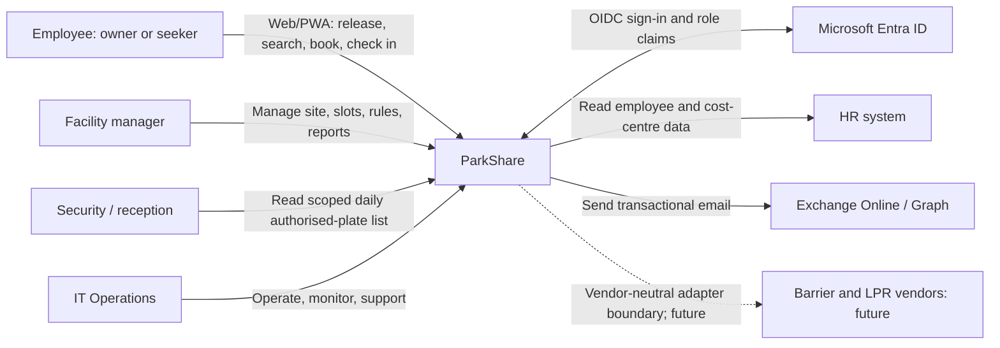
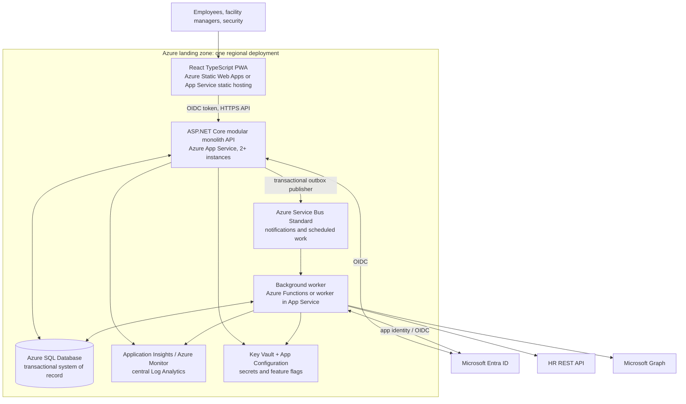
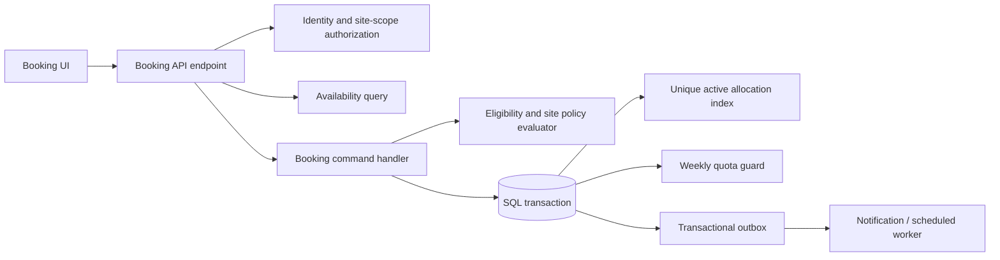
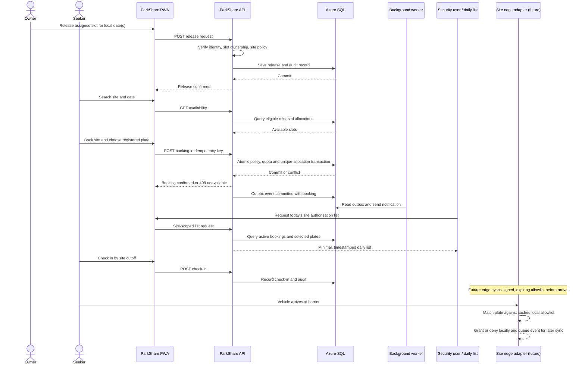

# ParkShare Architecture Challenge

**Role:** IT Application Architect  
**Date:** 2026-11-20  
**Status:** Proposed architecture for discussion  
**Decision horizon:** Four-month MVP; two pilot sites before all-site rollout

## Executive Recommendation

Build ParkShare as a tenant-aware modular monolith on Microsoft Azure: a responsive React PWA, an ASP.NET Core API and background worker, and Azure SQL Database. Keep booking, policy evaluation, and slot release in one deployable application and one transactional database. Use database constraints as the final authority for booking exclusivity; do not introduce microservices, a distributed cache, or a complex event platform for this scale. Use an outbox and a small managed queue for reliable notifications and scheduled work.

For the MVP, daily arrival confirmation in the PWA is the no-show signal because no barrier or LPR integration is in scope. At a site-configured cutoff (initial proposal: 10:00 local time), an idempotent job releases bookings without check-in, notifies the employee, and records the decision. Build a vendor-neutral integration boundary for future barriers, but defer the on-premises edge runtime until a barrier vendor and site operating policy are selected.

The main delivery risks are unclear no-show/fairness policies, privacy approval for plate data, the shared DevOps capacity, and proving the monthly cost and availability targets in the selected Azure region. Resolve policy and privacy questions in Sprint 0; validate cost, booking contention, and identity integration with a walking skeleton before broad feature work.

## 1. Assumptions and Open Questions

The detailed assumptions and stakeholder questions for this deliverable are maintained in [ParkShare: Assumptions and Open Questions](parkshare/01-assumptions-open-questions.md). The summary below is retained so this architecture response remains readable on its own.

### Assumptions

1. The first release serves one Contoso legal entity and 12 known sites. The schema carries a `TenantId` from the start, but onboarding, billing, and customer-configurable tenancy are not MVP features.
2. Each slot has one accountable owner. A release only makes an assigned slot available for the specified local site date; it does not transfer ownership.
3. MVP bookings are full-day. Half-day periods, waitlists, lottery allocation, visitor bookings, EV charging sessions, and external customers are excluded.
4. A booking is for one slot on one or more local site dates. Multi-date requests are committed atomically: all requested dates succeed or none do.
5. Entra ID is the corporate OIDC provider. HR REST is authoritative for employee identity, employment status, and cost centre; ParkShare stores only the fields needed for operation.
6. Facility managers configure site rules and no-show policy. The initial no-show mechanism is employee check-in; LPR or barrier events are a later, site-approved signal.
7. Employees may have multiple licence plates, but each booking selects one plate. Plate changes are auditable and security access lists contain only the minimum fields required at the site.
8. Azure SQL Database is the system of record. Search is served from indexed SQL queries; expected volume does not justify a separate search service or cache initially.
9. The 99.5% target is measured during each site's defined business hours. One Azure region is acceptable for MVP; availability zones and tested restore procedures are required, not active-active multi-region.
10. The EUR 3,000/month target is an indicative Azure run-cost ceiling excluding VAT, internal staff, corporate shared services, and one-time pen-test costs. Finance and IT Operations will validate the selected region, support tier, and monitoring ingestion before production.

### Top 10 Stakeholder Questions

1. What is the authoritative policy for assigned slots, priority groups, eligibility, and tie-breaking when two eligible users compete?
2. When may an owner reclaim a released slot after a booking exists, and what happens to the seeker's booking and any compensation or notification?
3. Is employee check-in acceptable for pilot no-show detection, or must the system observe the vehicle? What is the grace period, cutoff, appeal, and manual override process?
4. Which sites and slot categories are in the pilot, and are local holidays, half-days, shift patterns, and time-zone boundaries required at launch?
5. What does “max bookings per week” mean: bookings made, days booked, or distinct attendance days? How are cancelled and priority bookings counted?
6. Which HR API fields, identifiers, rate limits, freshness guarantees, and deprovisioning events are available? Can HR access be delayed without blocking daily operations?
7. What is the lawful basis and approved retention schedule for licence plates, bookings, check-in/presence events, audit records, and security exports? What does the works council permit?
8. What user experience and control are required for daily security lists, visitors, correction of an incorrect plate, and offline access at sites?
9. Which Azure region, network boundaries, support plan, disaster-recovery RPO/RTO, key-management standard, and central logging service are mandated by the landing zone?
10. Which barrier/LPR vendors and protocols are likely, what must happen when a site loses cloud connectivity, and who owns edge-device support and physical overrides?

## 2. Architecture Overview

### System Context (C4)



### Container View (C4)



The frontend is a responsive installable PWA, not a separate native app. Authentication is OIDC with authorization enforced by the API on every request. App Service uses managed identity to access SQL, Key Vault, and Azure resources. The API and worker share a codebase and domain modules but run as separately scaled processes only if operationally useful; MVP can run the worker as an App Service background process or Functions trigger. Choose one execution model in Sprint 0 after validating deployment conventions and queue support.

### Booking Components



### Domain Model and Bounded Contexts

Deploy as one modular monolith with explicit module boundaries and no direct cross-module table writes. Modules communicate through application interfaces and domain events; synchronous booking decisions remain in one database transaction.

| Context | Main entities and responsibility |
|---|---|
| Identity & Access | `Tenant`, `Employee`, `RoleAssignment`, `SiteScope`; Entra subject is the stable login key, with HR identifiers mapped separately. |
| Site & Inventory | `Site` (IANA time-zone ID and business calendar), `Slot` (attributes, assigned owner, active state), `SlotRelease` (owner, local date/period, state). |
| Booking | `Booking` (requester, selected plate reference, state, idempotency key), `BookingAllocation` (slot/date/period uniqueness), `BookingPolicy` (window, quota, priority rules), `CheckIn`. |
| Security Access | `AuthorisedPlateExport` (site, local date, version, minimal plate set), `AccessEvent` (future adapter-normalised arrival/denial event). Avoid storing raw LPR imagery. |
| Notifications | `OutboxMessage`, `NotificationAttempt`, delivery status and retry metadata; notification failure does not roll back a booking. |
| Reporting & Audit | `AuditRecord` for administrative and security-sensitive actions; aggregate occupancy facts without unnecessary person-level history. |

Every business row is scoped to `TenantId`; site-specific permissions also require an explicit site scope. Plate values are stored separately from routine booking/reporting fields, encrypted in transit and at rest, and never emitted to application logs. Store site time as an IANA time-zone identifier and service dates as local calendar dates; store event timestamps in UTC. This avoids daylight-saving and cross-country errors.

## 3. Key Scenarios

The optional booking API contract is available as [OpenAPI 3.1](parkshare/booking-api.yaml).

### Owner Releases, Seeker Books, Vehicle Arrives

The MVP ends at a security-authorised daily plate list and employee check-in; direct barrier control is future scope. The final part of the sequence shows the future adapter path and is not a pilot dependency.



### No Double Booking Under Concurrent Load

Availability displayed to a user is advisory; only the booking transaction grants the slot. The database is the final arbiter, including when many users submit at the booking-window opening.

1. Each requested slot/date/period has a `BookingAllocation` with an `IsActive` flag. A filtered unique index on `(TenantId, SlotId, LocalDate, Period) WHERE IsActive = 1` enforces one active allocation. Cancellation or no-show deactivates the allocation in the same transaction that changes the booking; the booking history remains available for the approved retention period. SQL Server's unique-index enforcement serializes conflicting inserts; the losing request receives a domain conflict (`409 Conflict`), never a second booking.
2. In one SQL transaction, the command handler rechecks release state, booking window, employee eligibility, and site policy, then reserves the allocation and increments/guards the weekly quota. Multi-date requests reserve all rows or roll back all rows. Use a short transaction and a stable lock order to avoid deadlocks.
3. A client-supplied idempotency key is unique per employee and request. Retries after a timeout return the original result, not a second booking. Deadlock/transient retries are bounded and apply only to idempotent commands.
4. Unique-index conflicts are translated to a stable API error. Do not retry a genuine conflict. Add a concurrency integration test that races many requests for the same allocation and asserts exactly one active booking.
5. Booking-window opening is tested at forecast peak plus agreed headroom. Use autoscale, connection-pool limits, API rate limits, request timeouts, and fair queueing only if measured contention requires it. Do not claim that a cache or client-side lock prevents double booking.

For weekly quotas, a `UserSiteWeekQuota` row is locked/updated in the same transaction, or the relevant active allocations are counted under serializable semantics. Decide and test the exact week boundary and treatment of cancellations before implementing. SQL row-versioning may be enabled for read-heavy search, but the write path still uses constraints and explicit transaction semantics.

### No-Show Detection and Release

At each site's configured local cutoff (proposed default: 10:00), a scheduled job selects active bookings with no `CheckIn` and no valid arrival event. It claims work idempotently, transitions the booking to `NoShow`/`Released`, releases the active allocation, records a reason and policy version, and queues notifications in the outbox. The database transition uses a conditional update so repeated or overlapping job runs cannot release twice. A facility manager may correct an erroneous no-show with an audited override.

For the pilot, users check in through the authenticated PWA and receive a reminder before cutoff; this is the explicit MVP assumption. A site must opt in to automatic release, with a clear grace period and local-time configuration. If stakeholders require “car not seen by 10:00” rather than user check-in, that requirement depends on an arrival data source and must be moved behind the vendor-neutral access-event interface; the platform cannot infer vehicle presence without sensors or a manual security workflow. Future LPR events are normalised by vendor adapters and deduplicated by vendor event ID. Define offline and late-event rules before enabling automatic access decisions.

## 4. Architecture Decision Records

### ADR-001: Modular Monolith for MVP

**Context:** Four months, one small cross-functional team, moderate initial scale, and rules requiring atomic booking decisions.  
**Options:** Microservices; serverless function-per-capability; modular monolith.  
**Decision:** Modular monolith with explicit domain modules and a shared relational transaction boundary. Deploy one API and a background worker; extract a module only when scale, ownership, or a distinct availability boundary demonstrates the need.  
**Consequences:** Fast coherent delivery and straightforward consistency; modules need automated dependency-boundary checks and disciplined migrations. A single deployment is a shared failure boundary.

### ADR-002: Azure App Service and Azure SQL

**Context:** Azure is standard; the team knows .NET and SQL Server; target run cost is under EUR 3,000/month.  
**Options:** AKS; Azure Container Apps; App Service; Azure SQL versus Cosmos DB.  
**Decision:** Containerised ASP.NET Core on Azure App Service with at least two production instances, and Azure SQL Database with a supported general-purpose configuration. Keep a regionally redundant backup/restore plan and enable zone redundancy where supported and affordable. Use Bicep.  
**Consequences:** Low operational overhead and familiar relational constraints; Azure SQL and App Service are managed-service dependencies. Validate exact tier, zone support, region, licensing, private networking, and monthly cost in the landing zone before committing. AKS and Cosmos DB add complexity or weaken relational booking invariants without MVP benefit.

### ADR-003: PWA Instead of Native Mobile Apps

**Context:** Mobile skills are limited; users need web and phone access in four months.  
**Options:** Native iOS/Android; cross-platform native; responsive web/PWA.  
**Decision:** React and TypeScript responsive PWA, with installability and browser push where supported. Provide email as the reliable notification fallback; no native app in MVP.  
**Consequences:** One product surface and lower maintenance cost; push support and background execution vary by OS/browser. Check-in and booking must work in the browser without installation.

### ADR-004: SQL-Authoritative Booking and Asynchronous Side Effects

**Context:** No double booking is a hard invariant; daily and peak load are modest but bursty.  
**Options:** Distributed lock/cache; serialised booking service; relational constraints and transactions.  
**Decision:** Azure SQL unique filtered index plus atomic transactions, idempotency keys, and an outbox. Use Service Bus Standard for retriable notification/background work; never put booking correctness on queue delivery.  
**Consequences:** Strong invariant with a simple operational model; contention and quota semantics require integration/load tests. Search stays indexed SQL until measurements justify a separate read model.

### ADR-005: Vendor-Neutral Edge Integration Boundary; Defer Edge Runtime

**Context:** At least two LPR vendors are future scope and barriers must remain usable during cloud loss.  
**Options:** Direct vendor calls from the domain; vendor-specific modules; canonical access-event contract plus adapters and local edge agent.  
**Decision:** Define canonical `AuthorisationSnapshot`, `ArrivalEvent`, and `AccessDecision` contracts. Do not build an edge runtime in MVP. Before the first barrier pilot, deploy a site-local adapter with encrypted storage, signed and expiring snapshots, local decision capability, event replay, and operator override.  
**Consequences:** Keeps vendor details out of booking logic; offline revocation policy, device support, clock integrity, and physical safety require site-by-site design and testing. Cloud availability is not a prerequisite for the future local barrier decision.

### ADR-006: Tenant-Aware Data Without Premature SaaS Productisation

**Context:** External-customer SaaS is a possible future, but MVP is for one employer and cost/time are constrained.  
**Options:** No tenant boundary; tenant-aware shared schema now; full database-per-tenant SaaS now.  
**Decision:** Include `TenantId` and tenant-scoped authorization/query patterns from the first migration; seed one tenant. Do not build onboarding, billing, tenant self-service, or database-per-tenant operations in MVP.  
**Consequences:** Makes customer ownership explicit and lowers migration risk, but tenant filters become a security-critical invariant. Enforce them in API authorization and repository boundaries, and add cross-tenant isolation tests. Reassess isolation strategy before external customers.

## 5. Technology Stack, Frameworks, and Tooling

### Application Stack

| Layer | Proposal | Rationale |
|---|---|---|
| API | .NET 10 LTS, ASP.NET Core REST controllers, versioned OpenAPI | Matches in-house skills; stable support horizon and clear HTTP contracts. Pin SDK/runtime and follow Microsoft's LTS support policy. |
| Domain / validation | C# domain types; FluentValidation or equivalent approved validator; explicit mapping | Keep rules testable and prevent transport concerns leaking into domain. Avoid reflection-heavy implicit mappings for sensitive booking commands. |
| Data | Azure SQL Database, EF Core 10, reviewed migrations and targeted SQL indexes | Supports transactional invariants, reporting, and SQL Server expertise. Use parameterised queries; inspect generated SQL for search/booking paths. |
| Background work | Transactional outbox, Azure Service Bus Standard, .NET worker/Azure Functions | Reliable retries and dead-letter handling for notifications and scheduled no-show work; not part of booking commit. |
| Resilience | `Microsoft.Extensions.Http.Resilience`, bounded retries/timeouts/circuit breakers for HR and Graph | Prevent slow external dependencies from exhausting API capacity; never retry non-idempotent writes blindly. |
| Identity | Microsoft identity platform / MSAL where needed, Entra OIDC, managed identity service-to-service | Corporate identity and no stored application secrets where managed identity applies. Authorize site scope server-side. |
| Web | React, TypeScript strict mode, Vite, approved component library (e.g. Fluent UI) | Single responsive app aligned with Microsoft environment; select the supported major version during Sprint 0. |
| Frontend state | Server state via a small query/cache library only if needed; URL for searchable filters; local state for forms | Avoid duplicated state and unnecessary client-side booking authority. |
| Mobile | PWA, service worker for static shell and web push; online-only booking/check-in | Low-cost mobile reach. Do not cache plate or booking details for offline browsing. |
| Observability | OpenTelemetry-compatible traces/metrics/logs to Application Insights and central Azure Monitor | Correlate booking request, SQL transaction, outbox, and notification without logging plate data. |
| Edge (future) | .NET worker/container on approved site hardware; local encrypted SQLite cache and vendor-specific adapter | Reuse team skills; local barrier decisions survive cloud outage. Select hardware/runtime after vendor discovery. |

### Engineering Toolchain and Governance

| Concern | Proposal |
|---|---|
| Source / branching | Azure Repos Git; trunk-based short-lived feature branches, pull request to main, required reviewers and linked work item. No long-lived integration branch. |
| CI/CD | Azure Pipelines YAML; build, unit/integration checks, scans, signed artifact, deploy to dev/test/stage/prod with approvals and rollback. Use workload federation/managed identity where supported. |
| IaC / environments | Bicep modules; dev, test, staging, production subscriptions/resource groups per landing-zone policy. Production data never copied to lower environments. |
| Containerisation | OCI image for API/worker; Azure Container Registry; pin base images and scan before deploy. Local Docker Compose for API plus SQL dependency. |
| Tests | xUnit unit tests; SQL Server/Azure SQL-compatible integration tests; OpenAPI schema checks; Playwright E2E; k6 peak and contention tests. Use test data with synthetic plates. |
| Code quality | .NET analyzers, `dotnet format`, nullable enabled, ESLint, TypeScript strict, formatting checks, module-boundary architecture tests. Treat warnings as errors for owned code after baseline. |
| Security / dependencies | Microsoft Defender for DevOps or the corporate-approved SCA/SAST tools; NuGet and npm audit; secret scanning; container scanning; SBOM per release; triage SLA by severity. |
| API docs | OpenAPI generated from API, reviewed breaking-change diff, authenticated non-production Swagger UI only. |
| Observability | Azure Monitor alerts and dashboards; central logging workspace with restricted access and retention policy; synthetic health checks per region/site. |
| Feature flags | Azure App Configuration feature management or approved equivalent; flags have owner, expiry date, and rollback instructions. Never use flags as authorization. |

Selection criteria are: skills and corporate standards first, then security/support maturity, total cost, operational burden, licence, long-term maintenance, and portability. Avoid AKS, microservices, a separate cache/search cluster, native apps, and unapproved packages in MVP: each adds operations, cost, or duplicated functionality without meeting a demonstrated requirement. Vendor lock-in is accepted for managed identity, SQL, and Azure monitoring because Azure is mandated; isolate email, queue, and future barrier integrations behind interfaces where switching is plausible.

Maintain an approved technology list and lightweight tech radar with an owner and review date per framework. Pin dependency versions; review updates monthly and apply critical security updates on an expedited path. Upgrade .NET on supported LTS cycles, Node on supported LTS cycles, and frontend packages on a quarterly cadence unless security requires sooner. Generate an SBOM for each release. Block new dependencies without owner, maintenance/support evidence, licence review, vulnerability scan, and an explicit reason; quarantine abandoned or critical-vulnerable packages and track remediation to closure.

## 6. Cross-Cutting Concerns

### Security and Identity

Use Entra OIDC for workforce sign-in, MFA/Conditional Access per corporate policy, and short-lived tokens. API authorization combines role and resource scope: employees manage their own plates/releases/bookings; facility managers are restricted to assigned sites; security can read only the site's daily access list; administrators receive least privilege. HR deprovisioning disables access promptly. Validate issuer, audience, tenant, scopes, and object ownership on every API operation. Use managed identity, Key Vault, TLS, encryption at rest, private endpoints where required, and no secrets in source or pipeline variables. Complete threat modelling, OWASP ASVS L2 control mapping, dependency review, and an independent pen-test before go-live; remediate critical/high findings before production.

### GDPR and Data Retention

Complete a DPIA and works-council review before pilot. Document purpose, legal basis, access roles, data subjects' rights, processors, cross-border transfers, and retention. Keep only the selected plate on a booking and the minimum daily list needed by security. No continuous location tracking, raw plate imagery, or person-level occupancy analytics. Encrypt plates with application-level access controls in addition to database encryption; separate access paths, mask them in admin screens, and log who viewed/exported them without copying plate values into audit text.

Provisional retention proposal for DPO approval: check-in/arrival event details 30 days; booking-identifying data 90 days after the service date; security/audit metadata 12 months; aggregate occupancy after de-identification retained for trend reporting. Legal, works-council, and incident requirements may change these periods. Implement scheduled deletion/pseudonymisation with an auditable job and prove backups expire under the approved backup lifecycle. Never treat these proposed periods as a substitute for legal approval.

### Availability, Resilience, and Scalability

Run two or more API instances across availability zones where supported; configure Azure SQL backups, point-in-time restore, and a tested recovery runbook. Establish and test RPO/RTO with Operations; proposed MVP targets are RPO 15 minutes and RTO 4 hours, subject to business approval. A single-region outage remains a declared MVP limitation. Use health probes, graceful shutdown, bounded queues, dead-letter alerts, dependency timeouts, and circuit breakers. Bookings fail closed if the authoritative database is unavailable; stale search results cannot create a booking.

The projected user count is modest for SQL, but opening-window bursts are a specific test condition. Load-test realistic site/date searches plus contention; use query/index tuning and horizontal API scale before adding a cache. Keep external HR and Graph calls out of synchronous booking transactions. Notifications are eventually delivered and retry independently.

### Deployment, Testing, and Operations

Separate dev/test/stage/prod and identities; apply least-privilege RBAC. Use immutable, scanned build artifacts promoted through environments. Database migrations are reviewed, backward-compatible where possible, and applied as a controlled release step with rollback/forward-fix instructions. Feature flags guard pilot-site enablement and staged rollout. Require a release checklist, change record, on-call contact, and support handover.

Testing pyramid: domain unit tests for every policy; SQL integration tests for constraints, isolation, and concurrency; API contract tests for error and authorization behavior; E2E tests for release-book-check-in-cancel; accessibility/localisation and DST-boundary checks; load tests for opening-window bursts; restore and failure-injection exercises for queue, Graph, HR, and database dependencies. Pen-test and privacy acceptance are release gates, not backlog aspirations.

### Indicative Monthly Run Cost

| Service | Planning range (EUR/month) |
|---|---:|
| App Service production capacity (2 instances) and non-prod footprint | 350–850 |
| Azure SQL Database, backups, and storage | 400–1,000 |
| Static hosting, registry, queue, functions/background work | 50–250 |
| Key Vault, App Configuration, networking/private endpoints | 100–450 |
| Application Insights / Log Analytics ingestion and retention | 100–350 |
| **Indicative total** | **1,000–2,900** |

This is a planning envelope, not a quote. Region, zone redundancy, SQL tier, private networking, log volume, and corporate discounts can move it materially. Keep 20% headroom; set budget alerts at 70%, 85%, and 100%; sample low-value telemetry, cap noisy logs, and verify actuals during a representative pilot month. Do not weaken the 99.5% or privacy controls to fit the budget; revisit scope or obtain funding if validated pricing exceeds the ceiling.

## 7. Delivery Plan and Work Breakdown

### Epics, Features, and Example Stories

| Epic | Features | Dependencies | Size |
|---|---|---|---|
| E1: Secure platform foundation | Entra sign-in, tenant/site authorization, CI/CD, telemetry, database migrations | Landing zone, Entra app registration, HR API access | L |
| E2: Sites and inventory | Site/slot CRUD, attributes, owner assignment, audit | E1; facility data and role model | M |
| E3: Release and discover | Owner releases; site/date search; local-time rules | E2; calendar and eligibility policy | M |
| E4: Book and manage | Atomic booking, weekly limits, cancellation, idempotency | E3; confirmed quota and priority semantics | L |
| E5: Daily operations | Check-in, no-show release, notifications, security plate export | E4; privacy/security approval; Graph access | L |
| E6: Reporting and rollout | Occupancy dashboard, performance/security hardening, pilot and staged rollout | E2–E5; site champions, pen-test | M/L |

**Story: Release an assigned slot.** As a slot owner, I can release my assigned slot for one or more eligible future dates so another employee can use it. Acceptance criteria: only the authenticated owner or an authorised facility manager can release it; invalid dates or dates outside the site's policy are rejected with a field-level error; all dates in a multi-date release commit atomically; release and reversal are audited; the seeker search reflects the release within five seconds.

**Story: Book an available slot.** As an eligible employee, I can book a released slot and know immediately whether I succeeded. Acceptance criteria: the API revalidates availability, eligibility, booking window, and weekly quota at commit time; two simultaneous requests for the same slot/date result in exactly one active booking and one conflict response; repeating the same idempotency key returns the original result; a booking notification is queued only after the transaction commits; errors do not reveal another employee's personal data.

**Story: Check in and release a no-show.** As an employee, I can confirm arrival for today's booking; as a facility manager, I can configure the site's cutoff and review exceptions. Acceptance criteria: check-in is accepted only for the employee's active booking at the correct site/date; a reminder is sent before the configured cutoff; an un-checked-in booking is released once after the cutoff when auto-release is enabled; the employee is notified and a facility manager can correct the outcome with an audit record; site-local time and daylight-saving transitions are tested.

### Sprint and Release Plan (8 Two-Week Sprints)

| Sprint | Outcome and exit evidence | Primary allocation |
|---|---|---|
| 0 | Walking skeleton: repo/pipeline, Bicep environments, API/PWA deploy, Entra proof, SQL migration, logging, threat model, policy/privacy workshops, cost estimate. | Architect + DevOps lead platform; backend pair; frontend skeleton; QA automation baseline; PO resolves policy questions. |
| 1 | Entra sign-in, tenant/site authorization, employee/plate profile, audit foundation; deploy to test. | Backend: identity/API; frontend: shell/profile; QA: auth/security tests; architect: boundaries/reviews. |
| 2 | Facility manager site/slot master data and ownership; HR sync contract stubbed and tested. | Backend: inventory/HR adapter; frontend: manager screens; QA: API/role tests; PO: pilot data. |
| 3 | Owner release and site/date availability search; local-time/holiday rules baseline. | Backend: release/search; frontend: owner and seeker flows; QA: boundary/DST tests. |
| 4 | Booking transaction, quota, idempotency, cancellation; concurrency test is a release gate. | Backend pair: booking; frontend: booking UX; QA: SQL contention suite; architect: invariant review. |
| 5 | Check-in, no-show job, notifications, security daily list; retention deletion job. | Backend: worker/Graph/security export; full-stack: PWA check-in; QA: failure/retry/privacy tests. |
| 6 | Dashboard, load/security/accessibility testing, pen-test remediation, pilot rehearsal; go-live at two sites at sprint end. | Whole team on hardening; DevOps on production readiness; PO/facility/security run UAT; architect coordinates risk decisions. |
| 7 | Observe pilot, fix blocking defects, measure cost/SLO, roll out in waves to remaining sites with rollback gates. | Developers swarm on defects; QA validates each wave; DevOps monitors; PO and site champions approve readiness. |

This is a 16-week target with the pilot launching by week 12 and a four-week pilot/rollout window. Dates are conditional on timely identity, HR, policy, privacy, and site data access. If the pen-test or pilot reveals a release-blocking risk, protect safety/privacy and reduce scope rather than waive the gate.

### Sprint 0, Team Allocation, and Scope Control

Sprint 0 is a usable walking skeleton, not a slide-only architecture phase. Deliver a deployable “hello authenticated request” through the production-shaped pipeline; prove Entra and HR connectivity; prove a SQL transaction and unique-index race test; agree module/API conventions; establish dashboards, alerts, environments, threat model, DPIA owners, and a measured Azure cost estimate. Keep architecture decisions in short ADRs and review them as implementation evidence appears.

The two senior backend developers own identity/inventory and booking/integration respectively, pairing on the transaction invariant. The frontend developer owns the responsive React flows and accessibility. The full-stack/mobile-capable developer owns PWA/check-in and pairs on end-to-end flows. QA owns automation strategy, test data, concurrency and release evidence from Sprint 0. The shared DevOps engineer builds reusable pipelines/IaC and production operations; reserve their time early. The architect (50% hands-on) owns domain boundaries, security/privacy design coordination, ADRs, critical booking implementation/review, fitness functions, and cross-team decisions; delegates feature ownership and avoids becoming a delivery bottleneck. PO owns policy decisions, acceptance, and stakeholder access.

If the date is at risk, first defer half-day booking, Teams notifications, advanced reports, calendar auto-release, and visual polish. Keep identity/access control, correct inventory, no-double-booking, cancellations, check-in/no-show policy, security list, privacy/retention, accessibility basics, and production observability. Narrow pilot breadth before weakening any invariant or release gate.

## 8. Developer and AI Guidance Documentation

### Repository Documentation and Enforcement

Maintain `/docs/architecture/` with context/container diagrams, module ownership, data classification, ADRs, API/error conventions, operational runbooks, and a glossary. Add `/docs/development/local-setup.md`, `/docs/development/testing.md`, and `/docs/development/release.md`; keep a one-command local start with synthetic data. Put concise global instructions in `.github/copilot-instructions.md`, and narrower path-specific `.instructions.md` files for API/domain, data access, frontend, and infrastructure. Keep security and privacy rules close to the code they govern.

Update guidance in the same PR as a changed contract or architectural boundary. Assign an owner and review date to each decision/doc section; stale guidance is surfaced by a quarterly review. CI checks formatting, tests, OpenAPI diffs, dependency boundaries, IaC validation, secret/dependency/container scans, and SBOM generation. PR templates ask for affected modules, data classification, tests, telemetry, migrations, and documentation. Reviewers remain accountable for AI-assisted changes; generated code is not trusted because it compiles.

### Sample: `.github/copilot-instructions.md` for ParkShare

```markdown
# ParkShare Engineering Guide

## System Shape
- ParkShare is a modular monolith: Identity, Inventory, Booking,
  SecurityAccess, Notifications, Reporting, and Audit.
- Keep domain rules in their owning module. Do not write another module's
  tables directly; use its application interface or a documented event.
- Booking correctness is owned by Azure SQL transactions and the unique
  active-allocation index. Search results are advisory, never a reservation.
- The MVP has no barrier/LPR integration. Do not add vendor SDKs or infer
  presence from a plate list. Check-in is the approved pilot signal.

## Security and Privacy
- Treat employee IDs, licence plates, bookings, and check-ins as personal data.
- Enforce TenantId, role, site scope, and resource ownership in the API.
  A hidden UI control is not authorization.
- Never log licence plates, tokens, secrets, or raw HR payloads. Use opaque
  correlation IDs. Use managed identity; never hardcode credentials.
- Use parameterized SQL and validate external input on the server. Do not
  weaken authentication, authorization, TLS, CSRF, or audit controls.
- Do not add or change retention periods without DPO/works-council approval.

## API and Data
- Follow the versioned REST/OpenAPI conventions in /docs/architecture/api.md.
- Return stable problem-details errors; use 409 for an allocation conflict.
- Booking commands require an idempotency key and must be transactional.
  External calls and notifications must not run inside the booking transaction.
- Persist UTC instants and site-local service dates with an IANA time-zone ID.
- Schema changes require reviewed migrations and integration tests against SQL.

## Quality Gates
- Add behavior-focused unit tests and SQL integration tests for changed rules.
- Booking changes require a race test proving one active allocation wins.
- Run formatting, tests, analyzers, dependency/security scans, and OpenAPI
  checks before proposing a change. Do not disable or weaken a gate to pass.
- Add structured telemetry without personal data; update dashboards/runbooks
  when operational behavior changes.
- Prefer existing approved libraries and patterns. Explain any new dependency.
- Do not invent business policy: raise unresolved rules as questions and mark
  assumptions explicitly. Do not expose production data in examples or tests.

## AI Assistant Boundaries
- Do not commit, deploy, change cloud resources, alter permissions, or create
  external tickets unless explicitly requested and reviewed by a human.
- Do not claim tests, security reviews, or privacy approvals passed unless run
  and evidenced. Summarize changed files, behavior, tests, and remaining risks.
```

AI guidance is a starting point, not a control boundary. Protect source and prompts from confidential customer/employee data; use only the enterprise-approved Copilot tenant and retention settings; never paste real plates, HR records, secrets, or incident data into prompts. Review licensing/IP of generated dependencies and code under corporate policy. Require human review for authorization, SQL migrations, cryptography, retention, infrastructure, and generated tests. Track AI-originated defects through the normal quality process; do not use AI output as evidence of compliance.

## 9. Top Risks and Mitigations

| Risk | Likelihood / impact | Mitigation and trigger |
|---|---|---|
| No-show, priority, quota, or reclaim rules remain ambiguous | High / High | PO and facility/works council decision log in Sprint 0; encode policy versions and test scenarios. Block automatic release until site policy is signed off. |
| Plate and presence processing is not accepted by DPO/works council | Medium / High | DPIA and purpose/retention review before pilot; minimise fields and access, avoid raw imagery, validate daily list handling. Do not launch until approved. |
| Booking-window burst causes latency or database contention | Medium / High | Race and k6 tests at forecast peak plus headroom; enforce unique index and bounded transactions; tune before introducing cache/queueing. Alert on p95 and conflict/error rate. |
| HR/Entra/Graph access or API limits arrive late | Medium / High | Secure owners, credentials, contracts, rate limits, and test tenants in Sprint 0; use resilient adapters; define stale-profile behavior. Escalate unresolved access by Sprint 1 exit. |
| 99.5% target and EUR 3,000 budget conflict | Medium / High | Validate regional pricing, zone redundancy, private networking, and log ingestion early; cost alerts and pilot actuals. Obtain a scope/funding decision rather than silently reducing resilience. |
| Shared DevOps capacity delays environments and release | High / Medium | Reserve 0.5 FTE at kickoff; create standard IaC/pipeline templates in Sprint 0; keep architect/backend pair able to support; escalate blocked environment work within one sprint. |
| Pilot site data, training, or security process is not ready | Medium / Medium | Name site champions; conduct data validation, daily list rehearsal, support/runbook exercise, and rollback test before pilot. Roll out in waves. |
| Future LPR offline mode creates stale authorisations or vendor lock-in | Medium / High | Defer integration until vendor/policy selected; canonical adapter contract, signed expiring snapshots, local audit queue, explicit offline age/override policy, and vendor failure tests before site activation. |

## Decision Gates

- **End Sprint 0:** approved policy owners and open-question plan; Entra/HR connectivity proven; pipeline and deployment live; cost estimate and DPIA workstream started.
- **Before booking feature acceptance:** SQL uniqueness/concurrency test, quota semantics, cancellation and reclaim rules approved.
- **Before pilot:** works-council/DPO approval, pen-test high/critical findings closed, site security process rehearsed, support/rollback/restore runbooks tested, p95 and cost measured.
- **Before all-site rollout:** pilot SLO, support burden, no-show false-positive rate, and privacy handling reviewed with PO, Operations, and site stakeholders.
