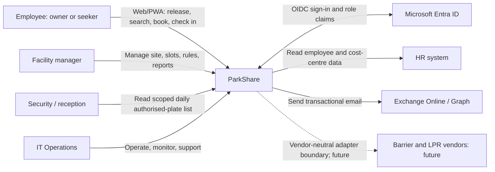
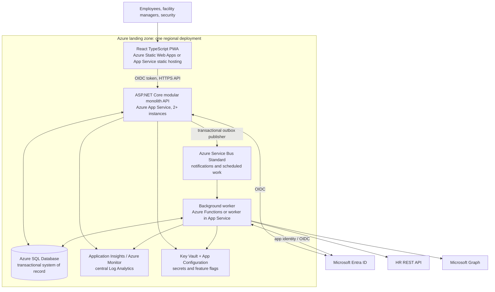
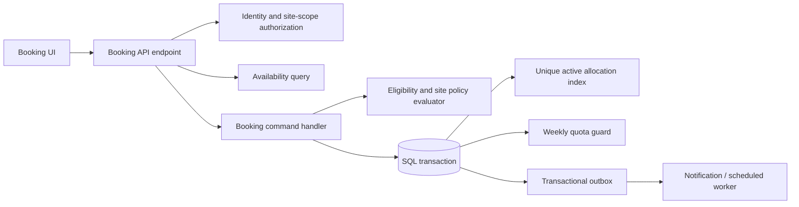

# 3.2 Architecture Overview

**Status:** Proposed for assessment; no implementation exists.  
**Source:** [3.1 Assumptions and Open Questions](01-assumptions-open-questions.md) and [integrated response](../parkshare-architecture-challenge.md).

## System Context (C4)

## Container View (C4)

The PWA is a presentation client; authorization is enforced by the API. The API and worker share a codebase/domain modules and the SQL transaction boundary. HR calls and notifications do not run inside booking transactions. The hosting alternatives shown are not selected; validate the worker runtime, database tier, region, networking, and monitoring against the corporate landing zone.

## Booking Components

Availability is advisory; the booking transaction is authoritative. The filtered unique active-allocation index prevents two active allocations for the same tenant, slot, local date, and period. Site policy and quota are rechecked at commit.

## Domain Model and Bounded Contexts

Deploy as a modular monolith with explicit module boundaries, no direct cross-module table writes, and synchronous booking decisions in one SQL transaction.

| Context | Main entities and responsibility |
|---|---|
| Identity & Access | `Tenant`, `Employee`, `RoleAssignment`, `SiteScope`; Entra subject is the login key and HR identifier is mapped separately. |
| Site & Inventory | `Site` (IANA time-zone ID and business calendar), `Slot` (attributes, assigned owner, active state), `SlotRelease` (owner, local date/period, state). |
| Booking | `Booking` (requester, selected plate reference, state, idempotency key), `BookingAllocation` (slot/date/period uniqueness), `BookingPolicy` (window, quota, priority rules), `CheckIn`. |
| Security Access | `AuthorisedPlateExport` (site, local date, version, minimum plate set), `AccessEvent` (future adapter-normalised arrival/denial event). Do not store raw LPR imagery. |
| Notifications | `OutboxMessage`, `NotificationAttempt`, delivery status and retry metadata; notification failure does not roll back a booking. |
| Reporting & Audit | `AuditRecord` for administrative/security-sensitive actions; aggregate occupancy without unnecessary person-level history. |

Every business row is tenant-scoped; site-specific authorization also requires site scope. Protect plate values separately from routine booking/reporting fields; never emit them in logs. Store site service dates as local dates with an IANA zone and event timestamps in UTC. Entity-level detail and isolation controls remain subject to review in 3.1.
