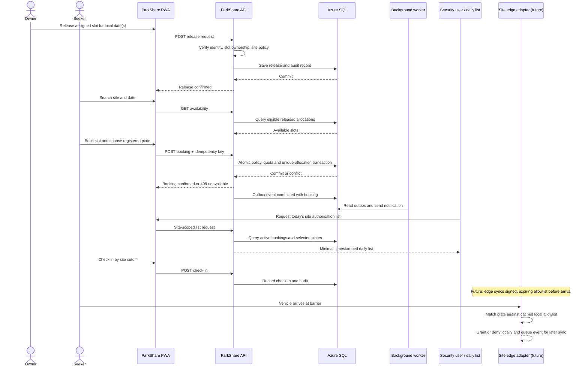

# 3.3 Key Scenarios

**Status:** Proposed flows; no implementation exists.  
**Related:** [Assumptions and Open Questions](01-assumptions-open-questions.md), especially questions 1–3 and 7–8; [proposed booking API contract](booking-api.yaml).

## Owner Releases, Seeker Books, Vehicle Arrives

For MVP, the flow ends with a site-scoped security list and employee PWA check-in. Direct barrier control is future scope; its local decision path below is illustrative only.

## No Double Booking Under Concurrent Load

Availability displayed to a user is advisory. Only the booking transaction grants the slot; SQL is the final arbiter, including at booking-window opening.

1. Each requested slot/date/period has a `BookingAllocation` with an `IsActive` flag. A filtered unique index on `(TenantId, SlotId, LocalDate, Period) WHERE IsActive = 1` enforces one active allocation. Cancellation/no-show deactivates the allocation in the same transaction that changes the booking.
2. In one SQL transaction, recheck release state, booking window, employee eligibility, site policy, and quota. Multi-date requests reserve all rows or roll back all rows; use short transactions and stable lock ordering.
3. Require a caller-scoped idempotency key. A retry returns the prior outcome, not a second booking. Bound retries to transient failures and idempotent commands.
4. Translate a unique-index conflict into a stable `409 Conflict`; do not retry genuine unavailability. Test races against SQL and assert exactly one active allocation.
5. Load-test forecast peak plus agreed headroom. Tune indexes and API/connection scaling before adding cache or queueing. Client-side locks and cached search results are not correctness controls.

For weekly quotas, update/check a `UserSiteWeekQuota` row in the same transaction or use isolation/locking that prevents oversubscription. The week boundary and treatment of cancellations are unresolved; see [3.1 question 2](01-assumptions-open-questions.md).

## No-Show Detection and Release

Proposed MVP assumption: authenticated PWA check-in is the arrival signal. At each site's configured local cutoff (10:00 is a candidate, not an approved value), an idempotent scheduled job selects eligible active bookings without check-in/valid arrival, transitions the booking to `NoShow`/`Released`, deactivates the allocation, records reason and policy version, and queues notification. A conditional update prevents overlapping/retried jobs from releasing twice. Facility-manager corrections are audited.

Enable automatic release only after the site approves the signal, cutoff, grace period, reminders, appeals, and override process. “Car not seen” cannot be inferred without LPR, barrier, or a manual security signal. Future vendor events require deduplication and explicit late/offline-event rules; see [3.1 questions 3 and 8](01-assumptions-open-questions.md).
