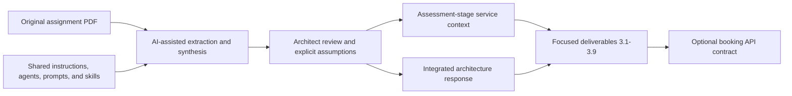

# ParkShare Assessment Package

**Status:** Discovery / PoC / Assessment  
**Product Owner / Service Owner:** Eurofins  
**Architect:** Gustavo Rocha  
**Support Team:** None assigned  
**Project reference:** None; assessment only  
**Date:** 2026-11-20

This folder contains the nine focused working deliverables for the ParkShare take-home assessment. The integrated [architecture challenge response](../parkshare-architecture-challenge.md) remains the concise, self-contained hand-in view; keep its content aligned with these focused files as the assessment evolves.

## AI-Assisted Ways of Working

I use AI as a collaborator throughout the SDLC, not as a one-shot document generator. I ask it to clarify and challenge requirements, identify assumptions and open questions, analyze alternatives, propose and draft artifacts, and review consistency and quality. I remain accountable for decisions, scope, and final review. In this assessment, AI helped produce and refine architecture and planning artifacts; no ParkShare application code was implemented.

### How the Repository Guides AI

The repository separates **how AI should work** from **what it needs to know about the service**:

- Shared organization instructions establish cross-cutting engineering, security, governance, and workflow expectations.
- Agents define role-oriented workflows; prompts provide reusable task entry points; skills provide more specialized procedures.
- The service context provides project-specific grounding: stakeholders, goals, system boundaries, requirements, proposed architecture, data/privacy constraints, integrations, operations, and unresolved decisions.

Together, these let an agent apply a consistent process to ParkShare without treating assumptions as facts or rebuilding the project context from scratch. The service-context file is approved as an **assessment baseline only**. It is not evidence of an implementation and does not authorize production use.

### From Assignment to Deliverables

The original [assignment PDF](../ApplicationArchi-homework.pdf) is the source. The integrated [ParkShare architecture response](../parkshare-architecture-challenge.md) is an AI-assisted extraction and structured synthesis of that brief: it organizes the requested work into the nine deliverables, carries through explicit constraints, and makes assumptions and unanswered questions visible. I reviewed and directed that synthesis; it is not a verbatim copy of the PDF or an independently validated implementation design.

The [assessment-stage service context](../../.github/service-context.md) and integrated response are the foundation for the focused documents. The context acts as shared domain memory and a boundary for future AI-assisted work; the response is the readable end-to-end proposal. The nine files below expand each deliverable, while the optional OpenAPI contract makes the proposed booking surface more concrete.

### Applying This Process Across the SDLC

The same approach extends beyond this assessment:

1. **Discover and refine:** use AI to extract goals, actors, constraints, ambiguities, assumptions, and questions for stakeholders.
2. **Design:** ask it to compare options, test scenarios and failure modes, and draft diagrams, decisions, contracts, and risks against the service context.
3. **Plan and build:** derive work slices and acceptance criteria; use coding agents within repository and module guidance when implementation begins.
4. **Verify:** review generated changes as a human, run the relevant automated checks, and use AI to help analyze failures or identify missing cases. AI output is not proof that a requirement or security control passed.
5. **Maintain context:** update the service context and focused artifacts when approved decisions or implementation evidence change; keep assumptions and deferred questions explicit until resolved.

For this assessment, the deliverables stop at a proposed design and an OpenAPI contract. The sequence describes my SDLC practice, not work completed on a running ParkShare service.

## Deliverables

| Item | Deliverable | Working file |
|---|---|---|
| 3.1 | Assumptions and open questions | [01-assumptions-open-questions.md](01-assumptions-open-questions.md) |
| 3.2 | Architecture overview: C4 context/container, booking components, domain model | [02-architecture-overview.md](02-architecture-overview.md) |
| 3.3 | Key scenarios and booking consistency | [03-key-scenarios.md](03-key-scenarios.md) |
| 3.4 | Architecture Decision Records | [04-architecture-decisions.md](04-architecture-decisions.md) |
| 3.5 | Technology stack, frameworks, tooling, and governance | [05-technology-and-tooling.md](05-technology-and-tooling.md) |
| 3.6 | Cross-cutting concerns | [06-cross-cutting-concerns.md](06-cross-cutting-concerns.md) |
| 3.7 | Delivery plan and work breakdown | [07-delivery-plan.md](07-delivery-plan.md) |
| 3.8 | Developer and AI guidance | [08-developer-ai-guidance.md](08-developer-ai-guidance.md) |
| 3.9 | Risks and mitigations | [09-risks.md](09-risks.md) |

## Optional Bonus

- [Proposed booking API contract (OpenAPI 3.1)](booking-api.yaml)

## Source and Status Notes

- The assignment is the source for stated business constraints; its intentional gaps are recorded in 3.1.
- Proposed design choices are not approved implementation facts. No ParkShare code or deployment was found in the repository.
- Unresolved business, privacy, integration, and platform decisions remain assumptions/open questions until owners answer them.
- The approved assessment-stage service context is [../../.github/service-context.md](../../.github/service-context.md).
- The original supplied assignment is [../ApplicationArchi-homework.pdf](../ApplicationArchi-homework.pdf).
